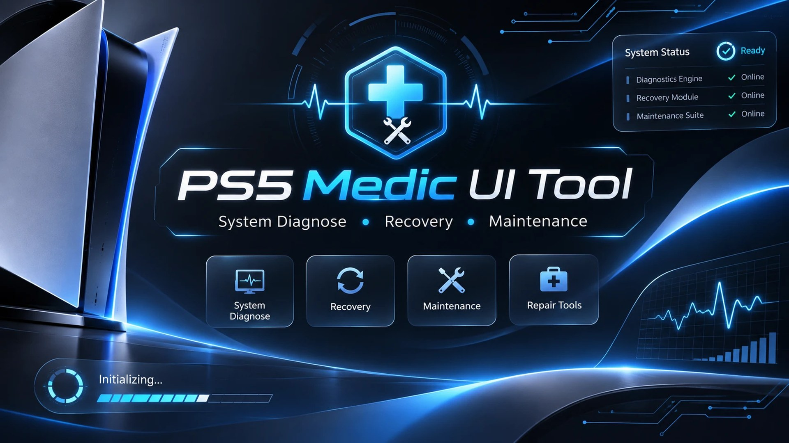
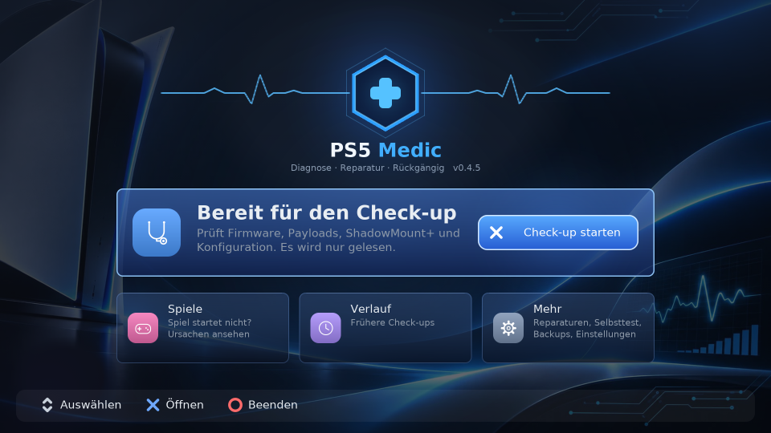
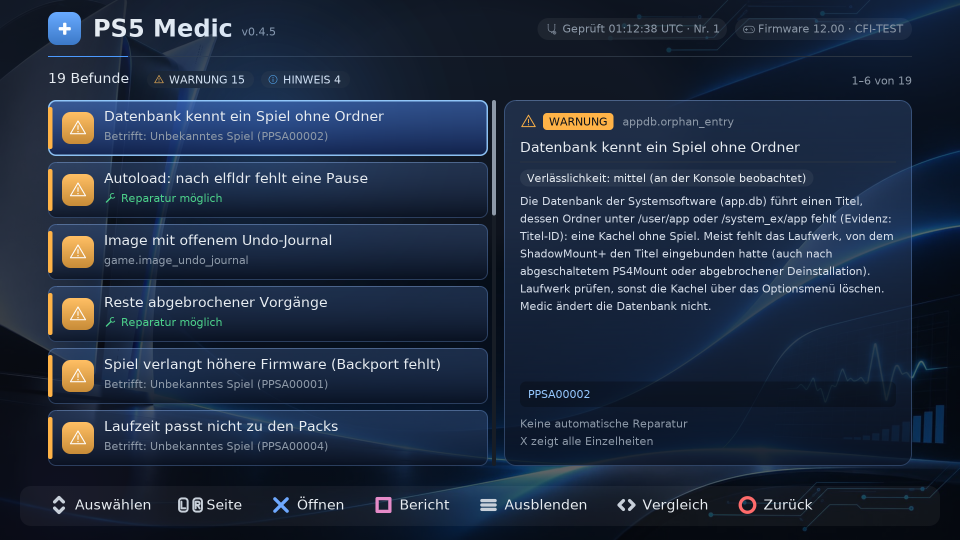
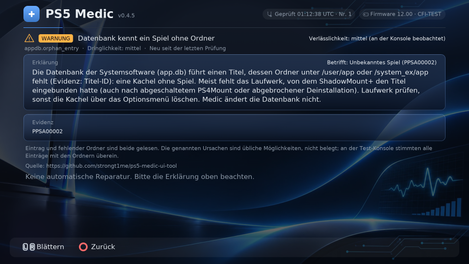
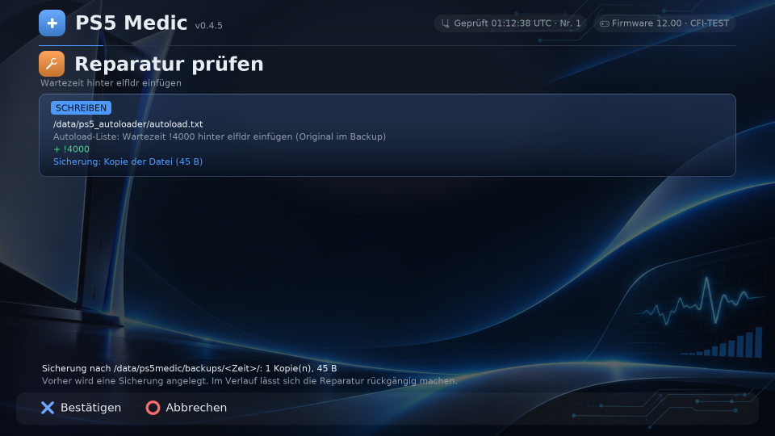
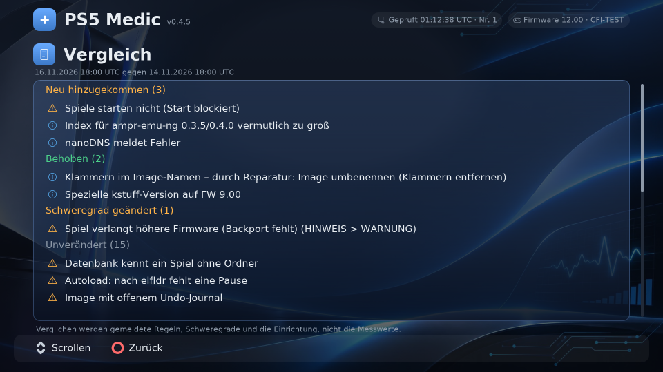
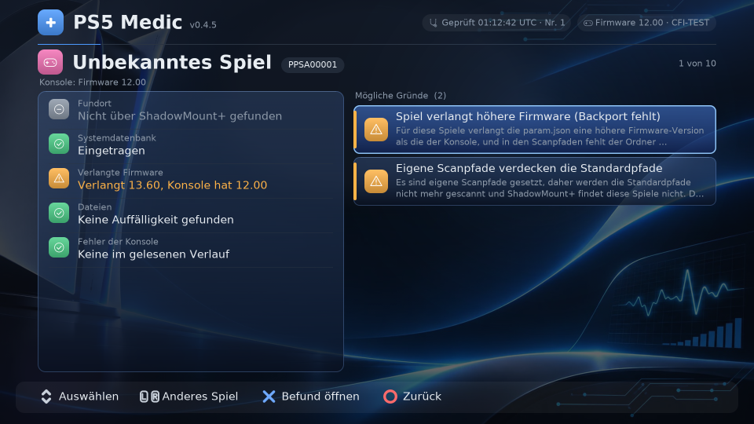
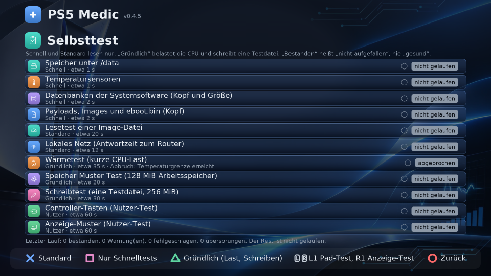
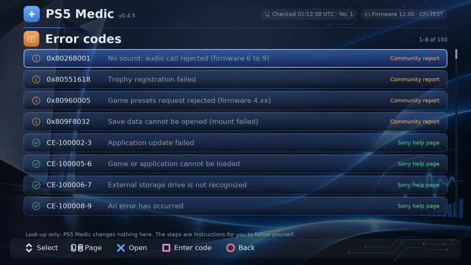
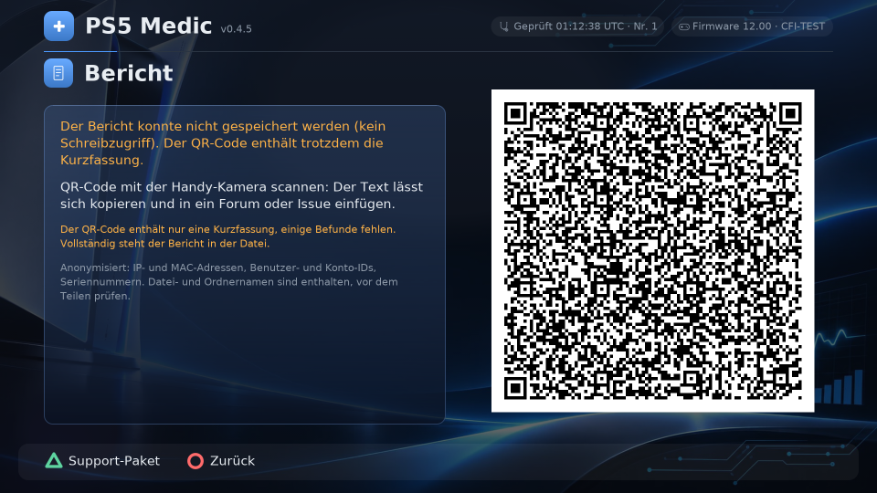

<div align="center">



# PS5 Medic

**Check-up, Klartext-Diagnose und sichere Reparatur für gejailbreakte PS5-Konsolen, als Vollbild-App für den Fernseher mit DualSense.**


[English](README.md) · **Deutsch** · [Français](README.fr.md) · [Italiano](README.it.md) · [Español](README.es.md)

**[⬇ Download: neuestes Release](https://github.com/strongt1me/ps5-medic-ui-tool/releases/latest)**



</div>

**PS5 Medic** prüft auf einer gejailbreakten PS5 den **Live-Zustand** des Homebrew-Setups (Firmware, Jailbreak-Kette, kstuff, ShadowMount+, Payloads, Spiele, Dateien, Konfiguration), erklärt bekannte Fehlerursachen **in Klartext** und repariert, wo das sicher möglich ist, **mit Backup und Rückgängig-Funktion**. Ein Knopfdruck: *Check-up starten*.

> **Firmware:** Die App unterstützt die Firmwares **1.00 bis 14.22** (soweit der Jailbreak dort läuft). Getestet wurde sie bisher auf einer PS5 Pro mit Firmware 12.00 und ShadowMount+ 1.7beta12. Andere Firmwares und Setups sind nicht getestet; die Regeln sind deshalb versionsgebunden formuliert und einzeln als *bestätigt* oder *noch nicht bestätigt* gekennzeichnet.

## Was es kann

<table>
  <tr>
    <td width="50%" valign="top">
      <h3>🩺 Check-up</h3>
      Über 100 Regeln zu Jailbreak-Kette und HEN, ShadowMount+, Plugins, Speicher, Spielordnern, Datenbanken, Konten, Kraken Mount, ampr-emu-ng sowie Start- und Fehlerverlauf. Jeder Befund hat Schweregrad, Klartext, Beleg (Datei/Zeile/Wert), Quelle und eine <b>Verlässlichkeit mit Grund</b>. Was nicht gelesen werden konnte, steht als <i>nicht geprüft</i>, nie als „in Ordnung“. Warnungen und Hinweise, die du nicht selbst beheben kannst, lassen sich mit <b>Options</b> ausblenden (nie kritische; steigt der Schweregrad, erscheinen sie wieder).
    </td>
    <td width="50%" valign="top">
      <h3>🎮 Pro Spiel</h3>
      <b>Spiel startet nicht?</b> Die Ansicht „Spiele“ bündelt alles zu einem Titel: Quellen (Ordner/Image), Eintrag in der Systemdatenbank, verlangte Firmware und Backport, Dateiprüfung, Fehler der Konsole, Spielstände, ShadowMount+-Log und die möglichen Gründe. Ist der <b>Backport im Spiel selbst eingebaut</b> (SDK-Version der <code>eboot.bin</code> liegt nicht über der Firmware), wird das erkannt und nicht als Fehler gemeldet.
    </td>
  </tr>
  <tr>
    <td valign="top">
      <h3>🛠 Reparieren mit Undo</h3>
      Vierzehn reversible Fixes (Image umbenennen, ShadowMount+-Schlüssel setzen, v1-Zeilen in die v2-Sektionen übertragen, BackPork aus dem Autoload nehmen, Duplikate verschieben, Autoload-Wartezeit, doppelte oder fehlende Autoload-Einträge, Autoload einschalten, defekte ELF-Datei oder leeres Image beiseitelegen, Dateiname mit falscher Schreibung, Reste abgebrochener Übertragungen und unvollständige Packordner beiseitelegen) und eine Anleitung für verschachtelte Images. Die Vorschau zeigt genau, was sich ändert <b>und was gesichert wird</b> (Kopie mit Größe, Verschieben ohne Kopie); nichts passiert ohne ✕. Jede Änderung steht im Journal und lässt sich zurücknehmen. <b>Nie löschen</b>, nur verschieben oder umbenennen.
    </td>
    <td valign="top">
      <h3>🧪 Selbsttest</h3>
      Elf Tests der Konsole: Speicher, Temperaturen, Datenbanken, Payloads und Images, Lesetest, lokales Netz (nur Router), Wärmetest, Speichermuster, Schreibtest, Controller-Tasten und Anzeige-Muster. Jeder Test sagt, was er <i>nicht</i> beweist.
    </td>
  </tr>
  <tr>
    <td valign="top">
      <h3>📚 Fehlercodes</h3>
      Nachschlagewerk zu 150 Meldungen wie CE-108262-9: Erklärung, Schritte laut Sony, Quelle als Text und QR-Code. Nach einem Check-up zeigt der Eintrag, was Medic an der Konsole sieht.
    </td>
    <td valign="top">
      <h3>🕑 Verlauf und Vergleich</h3>
      Jeder Check-up wird einzeln gespeichert. Der aktuellste steht oben, frühere lassen sich aufklappen. Der Vergleich zeigt neu, behoben (mit „durch Reparatur: …“, wenn Medic es behoben hat), Schweregrad geändert, unverändert und die <b>geänderte Einrichtung</b> (Firmware, Regelstand, Versionen von ShadowMount+, kstuff und ampr-emu-ng, Zahl der Spiele).
    </td>
  </tr>
  <tr>
    <td valign="top">
      <h3>📄 Bericht und Regel-Update</h3>
      Markdown-Bericht mit QR-Code fürs Handy (IP/MAC, Konto-IDs, Seriennummern werden entfernt). Das <b>Support-Paket</b> (△ im Bericht) ist ein ZIP mit Berichten, Fakten und Vergleich, in dem zusätzlich Spiel- und Titelnamen durch Platzhalter ersetzt sind; den Schlüssel dazu behältst nur du. Neue Regeln und Fehlercodes per Datei oder, nur auf Bestätigung, von der eigenen Adresse, <b>nur mit gültiger Ed25519-Signatur</b>.
    </td>
    <td valign="top">
      <h3>🌍 Fünf Sprachen</h3>
      Deutsch, English, Français, Italiano und Español (Einstellungen, die Wahl wird gespeichert). Bedienung mit dem DualSense.
    </td>
  </tr>
</table>

## Bilder

<table>
  <tr>
    <td width="50%"></td>
    <td width="50%"></td>
  </tr>
  <tr>
    <td width="50%"></td>
    <td width="50%"></td>
  </tr>
  <tr>
    <td width="50%"></td>
    <td width="50%"></td>
  </tr>
  <tr>
    <td width="50%"></td>
    <td width="50%"></td>
  </tr>
</table>

## Sicherheit

- **Nie löschen**, nur verschieben oder umbenennen. Dateien, die geändert werden, werden vorher gesichert (`/data/ps5medic/backups/`), jede Änderung steht im Journal (`/data/ps5medic/journal.jsonl`).
- **Kein Schreiben ohne ✕**: Reparatur und Rückgängig passieren erst nach ausdrücklicher Bestätigung auf der Vorschau. Weitere Schreibaktionen: der Bericht (□), das Regel-Update (✕ auf dem Angebot), die gewählte Sprache in `/data/ps5medic/config.ini`, die Ergebnisse jedes Check-ups (`/data/ps5medic/checks/`, für den Verlauf und den Vergleich), das Journal und die eine Testdatei des gründlichen Selbsttests in `/data/ps5medic` (wird überschrieben, nie gelöscht).
- Reparaturen schreiben nur in einer Whitelist (ShadowMount+-Ordner, Autoload-Listen, die eigenen Scanpfade, `/data/ps5medic`). Nie unter `/system`, `/system_ex`, `/dev` oder im Flash. Die Kachel ist ein Ordner unter `/data/homebrew/`, den du selbst kopierst oder den der Installer `ps5medic-launcher.elf` anlegt; die Kachel selbst erzeugt ShadowMount+.
- **Das Netz wird nur für den Regel-Download benutzt**, nur auf □ und Bestätigung, nur zur Adresse aus deiner `config.ini`, und es wird nichts gesendet außer einer GET-Anfrage. Daneben gibt es einen lokalen Netztest im Selbsttest: nur ein Verbindungsaufbau zum Router im privaten Adressbereich, ohne Daten, nie ins Internet.
- Keine Exploits, keine Firmware-Änderungen, keine Funktionen zum Beschaffen, Entsperren oder Verteilen von Spielen, Keys oder Firmware. PS5 Medic repariert die **Umgebung**, nicht Inhalte. Es empfiehlt nie ein Update der Systemsoftware.

## Voraussetzungen

- Eine bereits gejailbreakte PS5 mit ELF-Loader (Port 9021) und FTP (hier Port 2121).
- **ShadowMount+ muss laufen**: Es legt die Kachel an und gibt der App Zugriff auf `/data`. Ist es angehalten, meldet die App „Dienstdatei nicht lesbar“.
- Die Oberfläche besteht aus zwei Teilen: der **Kachel** (eine native App, die nur anzeigt und den DualSense liest, deshalb führt die PS-Taste ganz normal zum Homescreen) und dem **Dienst** `ps5medicservice.elf`, der die Konsole liest und das Bild zeichnet. Die App sendet den Dienst beim Start selbst an den ELF-Lader (Port 9021); **weder websrv noch ein Homebrew-Lader ist nötig**. Ohne Kachel läuft nur der Diagnose-Payload (`ps5medic.elf`).

## Installation

1. Die beiden Ordner aus dem Release per FTP nach `/data/homebrew/` kopieren: `PS5MEDIC` (Dienst `ps5medicservice.elf`, Diagnose-Payload `ps5medic.elf`, `rules.json`, `error_codes.json`, Icon) und `FAKE42007` (die native App).
   Alternativ ohne FTP: `ps5medic-launcher.elf` (eigene Datei im Release, nicht im Zip) an den ELF-Lader (Port 9021) senden (Payload Manager oder `nc <ip> 9021 < ps5medic-launcher.elf`). Er schreibt beide Ordner selbst, startet nichts und löscht nichts; Protokoll: `/data/ps5medic/installer.log`.
2. ShadowMount+ legt innerhalb von Sekunden die Kachel **PS5 Medic** unter „Medien“ an.
3. Ein Druck auf die Kachel startet die App (erst das Startbild, dann der Startbildschirm). Beim Start sendet sie den Dienst an den ELF-Lader (Port 9021), der laufen muss; ein Neustart der Konsole ändert daran nichts, die Kachel bleibt. ◯ auf dem Startbildschirm beendet App und Dienst.

Die Kachel `FAKE42007` ersetzt die früheren Wege (Launcher, websrv, Kacheln `FAKE42008` und `FAKE42009`). Stehen noch alte Kacheln da, lassen sie sich in den Speichereinstellungen der PS5 entfernen. Einzelheiten zur App: [docs/NATIVE.md](docs/NATIVE.md).

## Bedienung

| Bildschirm | Tasten |
|---|---|
| Start | ↑↓ wählen · ✕ öffnen · ◯ beenden |
| Befundliste | ↑↓ wählen · L1/R1 Seite · ✕ Details · △ Reparieren/Anleitung · □ Bericht · ◯ zurück |
| Befundliste (weiter) | Options ausblenden · ← Vergleich mit dem letzten Check-up · → ausgeblendete Befunde · im Bericht △ Support-Paket |
| Detail | ←→ vorheriger/nächster Befund · △ Reparieren · □ Fehlercode · ◯ zurück |
| Reparatur-Vorschau | ✕ bestätigen (schreibt) · ◯ abbrechen |
| Spiele | ↑↓ wählen · ✕ öffnen · L1/R1 anderes Spiel · ◯ zurück |
| Verlauf, Selbsttest, Fehlercodes | Hinweisleiste unten zeigt die Tasten |

## Diagnose-Payload

`ps5medic.elf` läuft ohne Oberfläche, **nur lesend**: Er schreibt `/data/ps5medic/last_check.txt` und exportiert den Zustand als Snapshot nach `/data/ps5medic/snapshots/`. Den Snapshot kann man am PC mit `medic-cli check` prüfen (Fixture-Ordner, siehe unten).

## Aus dem Quelltext bauen

Linux oder WSL, CMake, ein C++20-Compiler. Der Kern und die Regeln laufen auch am PC gegen Fixture-Ordner.

```bash
make test        # Unit-, Regel-, UI- und Berichts-Tests gegen alle Fixtures
make host        # medic-cli und die PC-Vorschau der UI
make preview SNAP=tests/fixtures/g1_pos OUT=build/preview PREVIEW_ARGS="--lang fr"   # Bilder der UI am PC (de en fr it es)
```

Für die Konsole braucht man das [ps5-payload-sdk](https://github.com/ps5-payload-dev/sdk) **Version 0.50** (`PS5_PAYLOAD_SDK`) und SDL2 für die PS5 (nur für die PC-freie Ausweich-UI); die Bauanleitung dafür steht in [docs/PHASE3.md](docs/PHASE3.md), Aufbau und Bau der nativen App in [docs/NATIVE.md](docs/NATIVE.md).

```bash
make native-ui                      # native App (build-native/FAKE42007)
make ps5-service                    # Dienst (ps5medicservice.elf)
make ps5                            # Diagnose-Payload (ps5medic.elf)
make deploy-native PS5_HOST=192.168.1.x # App und Dienst per FTP nach /data/homebrew (die App muss dafür ganz geschlossen sein)
make send-launcher PS5_HOST=192.168.1.x # Installer an Port 9021 senden: schreibt App und Dienst selbst nach /data/homebrew (ohne FTP)
make dist                           # Release-Ordner und Zip unter dist/ (nur lokal)
```

Werkzeuge am PC (`build/medic-cli`):

```bash
medic-cli check   <snapshot-ordner>            # Befunde
medic-cli report  <snapshot-ordner> [--qr]     # Bericht, optional QR-Code im Terminal
medic-cli fix     <snapshot-ordner> <regel-id> # Plan ansehen (mit --apply --yes ausführen, nur an einer Kopie!)
medic-cli history|undo|export ...
```

## Übersetzungen

Die Oberfläche steht in `ui/i18n/<sprache>.json`, die Wissenstexte für Französisch, Italienisch und Spanisch liegen als Ergänzung in `knowledge/l10n/` (Regeln, Fehlercodes, Selbsttests). Fehlt ein Eintrag, zeigt die App Englisch. Berichte und die dynamischen Texte der Reparatur-Vorschau (Hinweise, Notizen, Warnungen und Fehlermeldungen) gibt es in allen fünf Sprachen; das Kommandozeilenwerkzeug `medic-cli` am PC kennt nur Deutsch und Englisch. `tools/l10n_extract.py` zieht die Quelltexte für Übersetzer, `tools/l10n_check.py <sprache>` prüft eine Übersetzung (Schlüssel, Platzhalter, Zahlen, Codes, Pfade).

## Mitmachen

**Tester gesucht** (andere Firmwares und Setups): [docs/TESTER.md](docs/TESTER.md). Probleme melden mit der Issue-Vorlage, den Bericht (□) einfügen.

Eine neue Regel braucht: einen Eintrag in `knowledge/rules.json` mit Quelle, ein Positiv- und ein Negativ-Fixture unter `tests/fixtures/` und `expect.json`. Die Tests erzwingen beides. Fixtures sind **synthetisch**: echte Datei- und Spielnamen gehören nicht ins Repo.

## Dokumentation

Die Dokumente gibt es auf Deutsch (`docs/`) und Englisch (`docs/en/`); oben steht jeweils ein Sprachumschalter.

| Datei | Inhalt |
|---|---|
| `CLAUDE.md` | Einstieg für Claude Code: Ziel, Stack, Grenzen, Arbeitsweise |
| `docs/SPEC.md` | Funktionen, Bedienung, Nicht-Ziele |
| `docs/ARCHITECTURE.md` | Module, Datenfluss, Regel-Format, Sicherheit |
| `docs/RULES.md` | Regelkatalog mit Quellen, Status und Abweichungen |
| `docs/DIAGNOSE.md` | Diagnose-Ausbau: gebaute Prüfungen, Entscheidungen D1–D21, Bauplan |
| `docs/ROADMAP.md` | Phasen 0–5 |
| `docs/PHASE2.md` bis `PHASE5.md` | Konsole und Snapshot, Oberfläche und App-Kontext, Bericht und Release, Regel-Update und Community |
| `docs/TESTER.md` | Mitmachen als Tester |
| `docs/COMMUNITY.md` | Berichte einsenden, wie daraus neue Regeln und Regel-Updates werden |
| `docs/NATIVE.md` | Die Oberfläche als native App: Kachel, Dienst, Protokoll, Stand |
| `docs/TITLE.md` | Älterer Weg (Starter, Launcher, websrv), nur noch als Ausweichweg |
| `knowledge/` | Regeln (`rules.json`), Fehlercodes (`error_codes.json`), Übersetzungen (`l10n/`) und JSON-Schemas |

## Lizenz und Danksagung

PS5 Medic steht unter der **GNU General Public License, Version 3 oder (nach Wahl) jeder späteren** (GPL-3.0-or-later). Der Lizenztext liegt in [LICENSE](LICENSE), jede eigene Quelldatei trägt eine SPDX-Zeile. Das gilt auch für die Regeldatenbank `knowledge/rules.json`. Grund: Der fertige ELF linkt gegen die GPLv3-Laufzeitbibliotheken des ps5-payload-sdk. Die Fremdkomponenten (MIT, zlib, BSD-2-Clause, DejaVu, stb_image) sind mit der GPL-3.0 vereinbar und stehen mit ihren Lizenzen in [THIRD_PARTY.md](THIRD_PARTY.md).

Das Repository ist **öffentlich**; fertige Pakete stehen unter [Releases](https://github.com/strongt1me/ps5-medic-ui-tool/releases). Wer ein Paket weitergibt, muss nach der GPL auch den Quelltext dazu anbieten.

PS5 Medic ist ein Community-Projekt und nicht mit Sony verbunden. Die Nutzung geschieht auf eigene Verantwortung.
