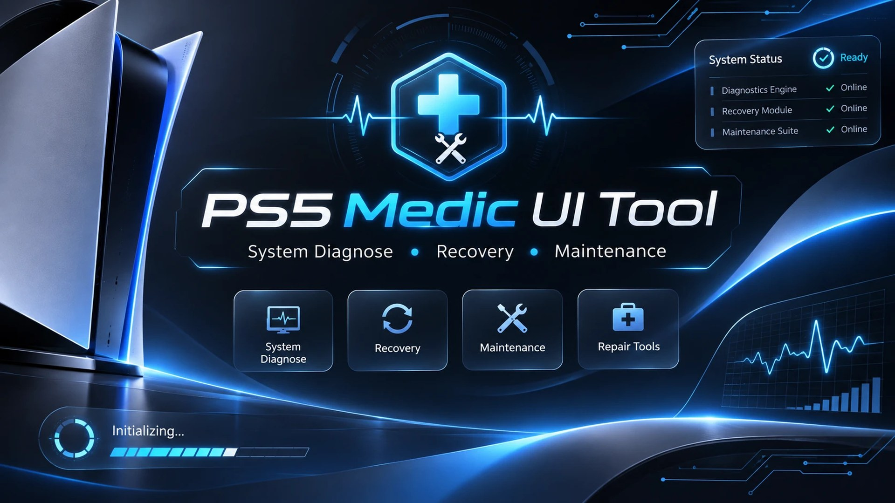
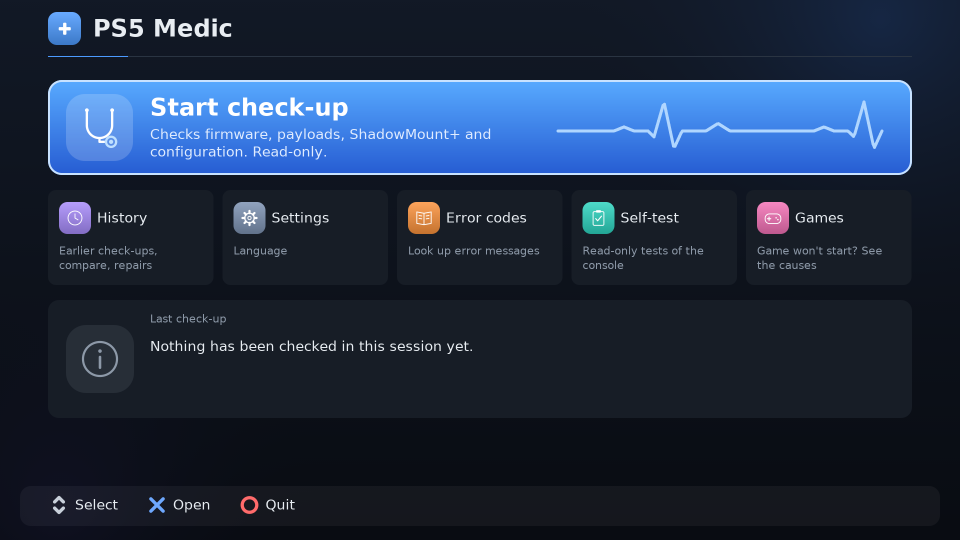
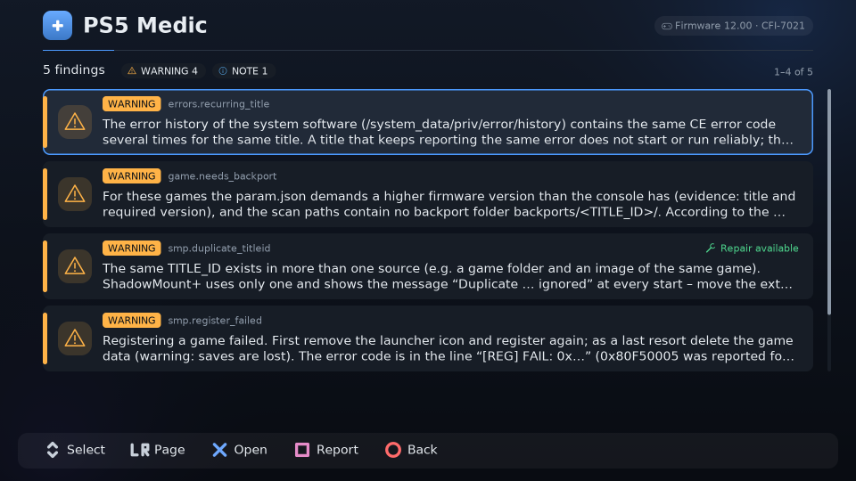
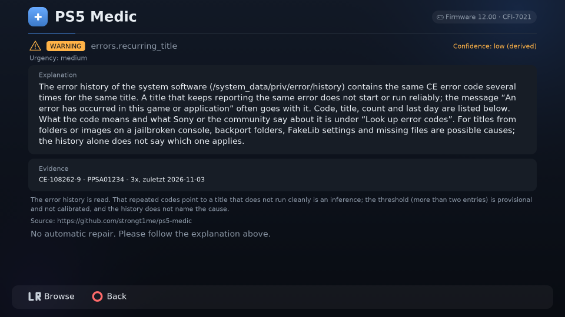
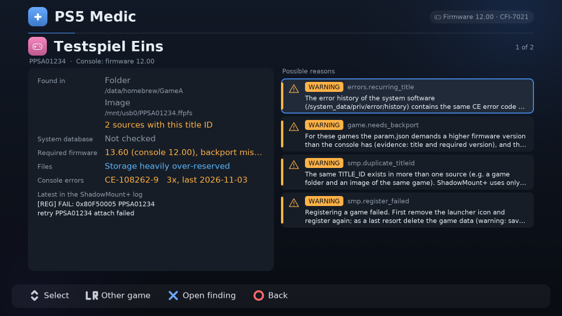
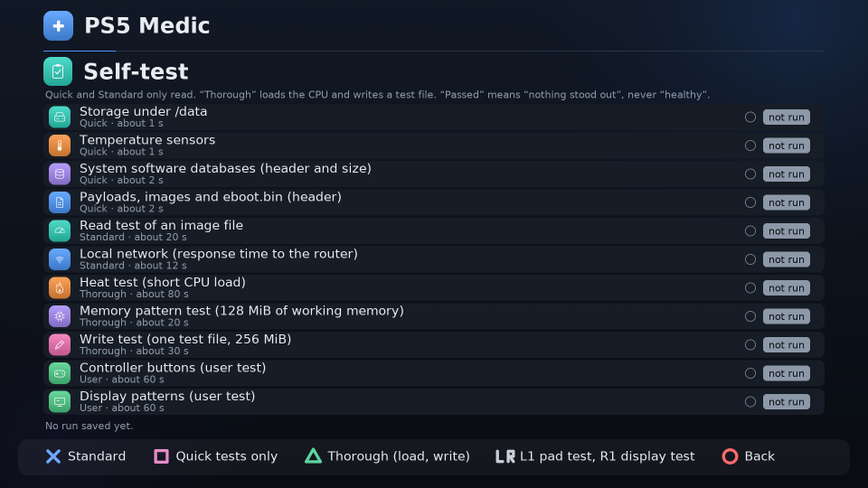
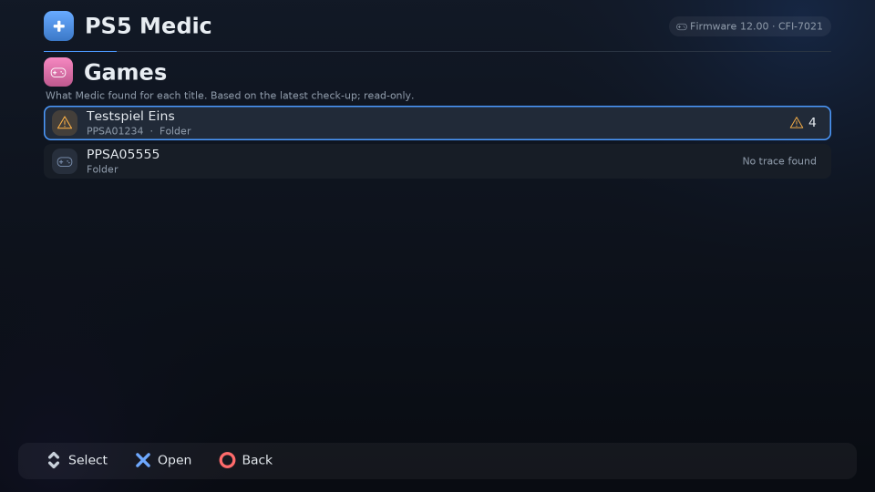
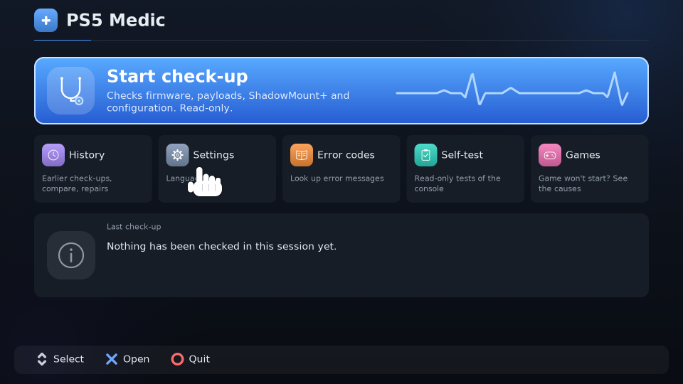

<div align="center">



# PS5 Medic

**Check-up, plain-language diagnosis and safe repair for jailbroken PS5 consoles, as a full-screen app for the TV with DualSense (or pointer).**


[Deutsch](README.md) · **English** · [Français](README.fr.md) · [Italiano](README.it.md) · [Español](README.es.md)



</div>

**PS5 Medic** checks the **live state** of the Homebrew setup on a jailbroken PS5 (firmware, jailbreak chain, kstuff, ShadowMount+, payloads, games, files, configuration), explains known causes of errors **in plain language** and, where it is safe to do so, repairs them **with backup and an undo function**. One button press: *Start check-up*.

> **Firmware:** The app runs on firmwares **4.00 to 14.10** (as far as the jailbreak works there). So far it has been tested on a PS5 Pro with firmware 12.00 and ShadowMount+ 1.7beta12. Other firmwares and setups have not been tested; the rules are therefore worded per version and each one is marked as *confirmed* or *not yet confirmed*.

## What it can do

<table>
  <tr>
    <td width="50%" valign="top">
      <h3>🩺 Check-up</h3>
      Over 70 rules on the jailbreak chain and HEN, ShadowMount+, plugins, storage, game folders, databases, accounts, and start-up and error history. Every finding has a severity, a plain-language explanation, evidence (file/line/value), a source and a <b>reliability with a reason</b>. Whatever could not be read is shown as <i>not checked</i>, never as "OK".
    </td>
    <td width="50%" valign="top">
      <h3>🎮 Per game</h3>
      <b>Game won't start?</b> The "Games" view gathers everything about one title: sources (folder/image), entry in the system database, required firmware and backport, file check, console errors, save data, ShadowMount+ log and the possible reasons. If the <b>backport is built into the game itself</b> (the SDK version of the <code>eboot.bin</code> is not higher than the firmware), this is recognised and not reported as an error.
    </td>
  </tr>
  <tr>
    <td valign="top">
      <h3>🛠 Repair with undo</h3>
      Seven reversible fixes (rename an image, set the ShadowMount+ key, carry v1 lines over into the v2 sections, take BackPork out of autoload, move duplicates, autoload wait time, file name with wrong capitalisation) and a guide for nested images. The preview shows exactly what changes; nothing happens without ✕. Every change is recorded in the journal and can be reverted. <b>Never deletes</b>, only moves or renames.
    </td>
    <td valign="top">
      <h3>🧪 Self-test</h3>
      Eleven tests of the console: storage, temperatures, databases, payloads and images, read test, local network (router only), heat test, memory pattern, write test, controller buttons and display patterns. Each test says what it does <i>not</i> prove.
    </td>
  </tr>
  <tr>
    <td valign="top">
      <h3>📚 Error codes</h3>
      Reference for 40 messages such as CE-108262-9: explanation, steps according to Sony, source as text and QR code. After a check-up, the entry shows what Medic sees on the console.
    </td>
    <td valign="top">
      <h3>🕑 History and comparison</h3>
      Every check-up is saved individually. Old states can be viewed and compared with each other: new, fixed, unchanged.
    </td>
  </tr>
  <tr>
    <td valign="top">
      <h3>📄 Report and rule update</h3>
      Markdown report with a QR code for your phone (IP/MAC, account IDs and serial numbers are removed). New rules and error codes by file or, only on confirmation, from your own address, <b>only with a valid Ed25519 signature</b>.
    </td>
    <td valign="top">
      <h3>🌍 Five languages, controller and pointer</h3>
      Deutsch, English, Français, Italiano and Español (settings, the choice is saved). Operation with the DualSense; in addition a <b>pointer</b> (right stick, R3 or touchpad press to click; mouse events are understood as well) with arrow and hand.
    </td>
  </tr>
</table>

## Images

<table>
  <tr>
    <td width="50%"></td>
    <td width="50%"></td>
  </tr>
  <tr>
    <td></td>
    <td></td>
  </tr>
  <tr>
    <td></td>
    <td></td>
  </tr>
</table>

## Safety

- **Never deletes**, only moves or renames. Files that are changed are backed up beforehand (`/data/ps5medic/backups/`), and every change is recorded in the journal (`/data/ps5medic/journal.jsonl`).
- **No writing without ✕**: repair and undo happen only after explicit confirmation on the preview. Other write actions: the report (□), the rule update (✕ on the offer), the selected language in `/data/ps5medic/config.ini`.
- Repairs write only within a whitelist (ShadowMount+ folder, autoload lists, the app's own scan paths, `/data/ps5medic`). Never under `/system`, `/dev` or in flash. The only exception outside the repairs: if the launcher is sent as an ELF, it creates its own tile `FAKE42008`, and for that its program is placed under `/system_ex/app/FAKE42008` (as with any app created by an installer; details in [docs/TITLE.md](docs/TITLE.md)).
- **The network is used only for the rule download**, only on □ and confirmation, only to the address from your `config.ini`, and nothing is sent except a GET request. In addition there is a local network test in the self-test: only a connection set-up to the router in the private address range, without data, never to the internet.
- No exploits, no firmware changes, no functions for obtaining, unlocking or distributing games, keys or firmware. PS5 Medic repairs the **environment**, not content. It never recommends a system software update.

## Requirements

- An already jailbroken PS5 with an ELF loader (port 9021) and FTP (port 2121 here).
- To start with the DualSense, the UI needs an app context (otherwise the console does not open the controller; background: [docs/PHASE3.md](docs/PHASE3.md)). The tile's **starter** (a small native title that sends the launcher to the ELF loader) provides it; **neither websrv nor a Homebrew loader is needed**. Without the tile, only the diagnostic payload (`ps5medic.elf`) runs.

## Installation

1. Copy the `PS5MEDIC` folder from the release to `/data/homebrew/` via FTP (it contains `ps5medicui.elf`, `ps5medic-launcher.elf`, `ps5medic.elf`, `rules.json`, `error_codes.json`, `homebrew.js` and the icon).
2. Get the tile, in one of two ways:
   - **Send an ELF:** send `ps5medic-launcher.elf` to port 9021 (Payload Manager, or from the PC: `make send-launcher PS5_HOST=<PS5-IP>`). It creates the **PS5 Medic** tile (`FAKE42008`) on the home screen and starts the UI right away if no app is running.
   - **Folder app:** copy the `FAKE42007` folder from the release to `/data/homebrew/`; ShadowMount+ creates the tile. After that, pressing the tile starts the UI without an ELF having to be sent.
3. Pressing the tile starts the UI (first the splash screen, then the start screen). It needs only the console's ELF loader (port 9021); the tile remains after a restart.

The launcher closes only Homebrew fake apps (including the tile's starter) and system programs; it never closes a running game. Details: [docs/TITLE.md](docs/TITLE.md).

## Controls

| Screen | Buttons |
|---|---|
| Start | ↑↓ select · ✕ open · ◯ quit |
| Findings list | ↑↓ select · L1/R1 page · ✕ details · △ repair/guide · □ report · ◯ back |
| Detail | ←→ previous/next finding · △ repair · □ error code · ◯ back |
| Repair preview | ✕ confirm (writes) · ◯ cancel |
| Games | ↑↓ select · ✕ open · L1/R1 other game · ◯ back |
| History, self-test, error codes | The hint bar at the bottom shows the buttons |
| Pointer | **Right stick** moves it, **R3** or **touchpad press** clicks (like ✕); a click on the hint bar presses the button. Over selectable items the pointer turns into a hand; it disappears as soon as buttons are used. New: tested on the PC, not yet tried on the console. |

## Diagnostic payload

`ps5medic.elf` runs without a UI, **read-only**: it writes `/data/ps5medic/last_check.txt` and exports the state as a snapshot to `/data/ps5medic/snapshots/`. The snapshot can be checked on the PC with `medic-cli check` (fixture folder, see below).

## Building from source

Linux or WSL, CMake, a C++20 compiler. The core and the rules also run on the PC against fixture folders.

```bash
make test        # Unit, rule, UI and report tests against all fixtures
make host        # medic-cli and the PC preview of the UI
make preview SNAP=tests/fixtures/g1_pos OUT=build/preview PREVIEW_ARGS="--lang fr"   # UI images on the PC (de en fr it es)
```

For the console you need the [ps5-payload-sdk](https://github.com/ps5-payload-dev/sdk) **version 0.45** (`PS5_PAYLOAD_SDK`) and SDL2 for the PS5; the build instructions for it are in [docs/PHASE3.md](docs/PHASE3.md), the build of the tile in [docs/TITLE.md](docs/TITLE.md).

```bash
make ps5-ui                         # Full-screen UI (ps5medicui.elf)
make ps5                            # Diagnostic payload (ps5medic.elf)
make send-launcher PS5_HOST=192.168.1.x # Send the launcher to port 9021 (tile FAKE42008 + UI); make title = folder app FAKE42007; make launch-ui = old way via websrv
make dist                           # Release folder and zip under dist/ (local only)
```

Tools on the PC (`build/medic-cli`):

```bash
medic-cli check   <snapshot-ordner>            # Findings
medic-cli report  <snapshot-ordner> [--qr]     # Report, optionally QR code in the terminal
medic-cli fix     <snapshot-ordner> <regel-id> # View the plan (run with --apply --yes, on a copy only!)
medic-cli history|undo|export ...
```

## Translations

The interface is in `ui/i18n/<language>.json`; the knowledge texts for French, Italian and Spanish are provided as a supplement in `knowledge/l10n/` (rules, error codes, self-tests). If an entry is missing, the app shows English. Reports and the dynamic hints of the repair preview exist only in German and English. `tools/l10n_extract.py` pulls the source texts for translators, `tools/l10n_check.py <language>` checks a translation (keys, placeholders, numbers, codes, paths).

## Contributing

**Testers wanted** (other firmwares and setups): [docs/TESTER.md](docs/TESTER.md). Report problems with the issue template, pasting in the report (□).

A new rule needs: an entry in `knowledge/rules.json` with a source, a positive and a negative fixture under `tests/fixtures/` and `expect.json`. The tests enforce both. Fixtures are **synthetic**: real file and game names do not belong in the repo.

## Documentation

| File | Content |
|---|---|
| `CLAUDE.md` | Entry point for Claude Code: goal, stack, limits, way of working |
| `docs/SPEC.md` | Functions, operation, non-goals |
| `docs/ARCHITECTURE.md` | Modules, data flow, rule format, security |
| `docs/RULES.md` | Rule catalogue with sources, status and deviations |
| `docs/DIAGNOSE.md` | Diagnostic expansion: checks built, decisions D1–D21, build plan |
| `docs/ROADMAP.md` | Phases 0–5 |
| `docs/PHASE2.md` to `PHASE5.md` | Console and snapshot, interface and app context, report and release, rule update and community |
| `docs/TESTER.md` | Taking part as a tester |
| `docs/TITLE.md` | Tile and start without a Homebrew loader: starter, launcher, folder app |
| `knowledge/` | Rules (`rules.json`), error codes (`error_codes.json`), translations (`l10n/`) and JSON schemas |

## License and acknowledgements

PS5 Medic is licensed under the **GNU General Public License, version 3 or (at your option) any later version** (GPL-3.0-or-later). The license text is in [LICENSE](LICENSE), and every original source file carries an SPDX line. This also applies to the rule database `knowledge/rules.json`. Reason: the finished ELF links against the GPLv3 runtime libraries of the ps5-payload-sdk. The third-party components (MIT, zlib, BSD-2-Clause, DejaVu, stb_image) are compatible with the GPL-3.0 and are listed with their licenses in [THIRD_PARTY.md](THIRD_PARTY.md).

The repository is **private**, there is no public release (decision of the author, 8 Nov 2026). Anyone who passes on a package from `make dist` must, under the GPL, also offer the corresponding source code.

PS5 Medic is a community project and is not affiliated with Sony. Use is at your own risk.
