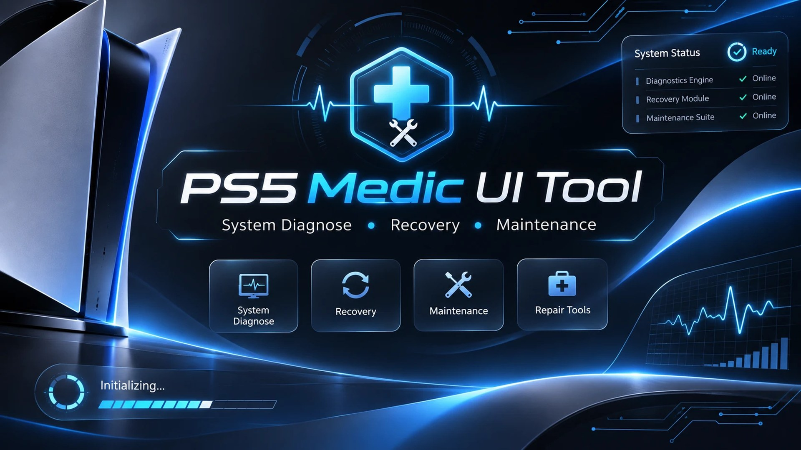
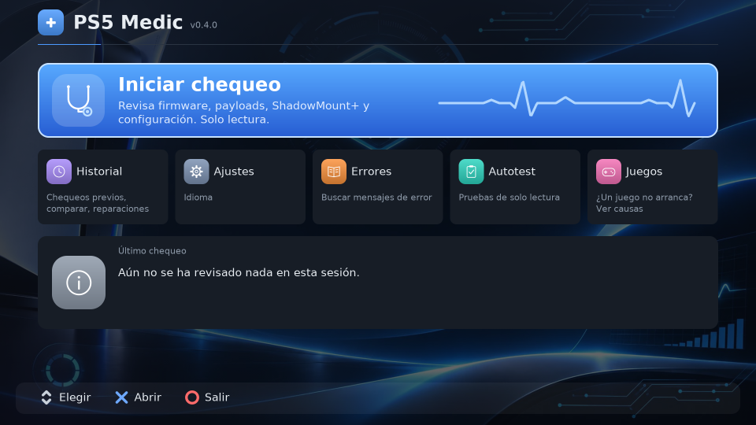
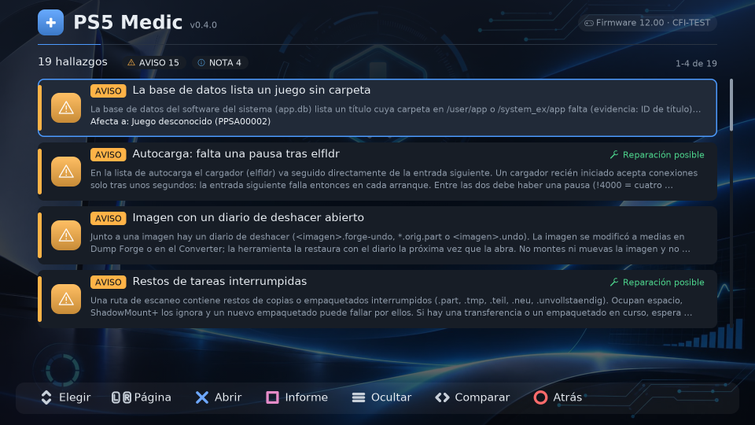
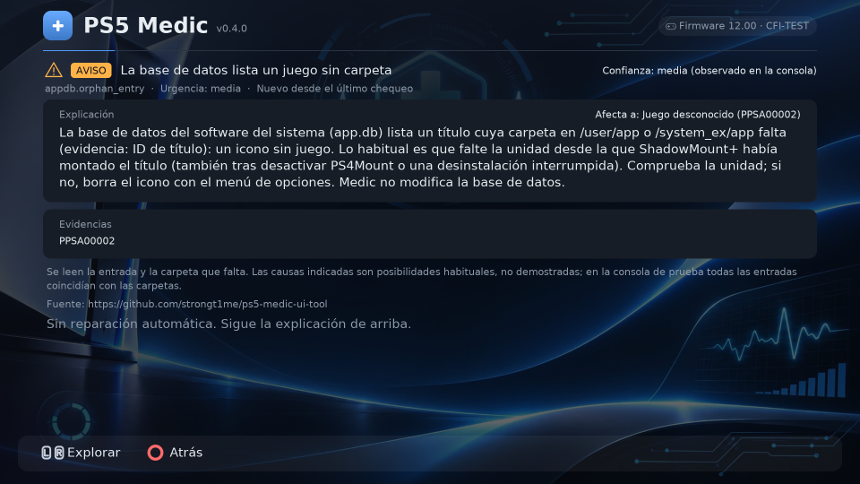
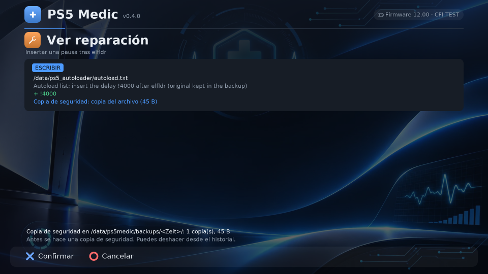
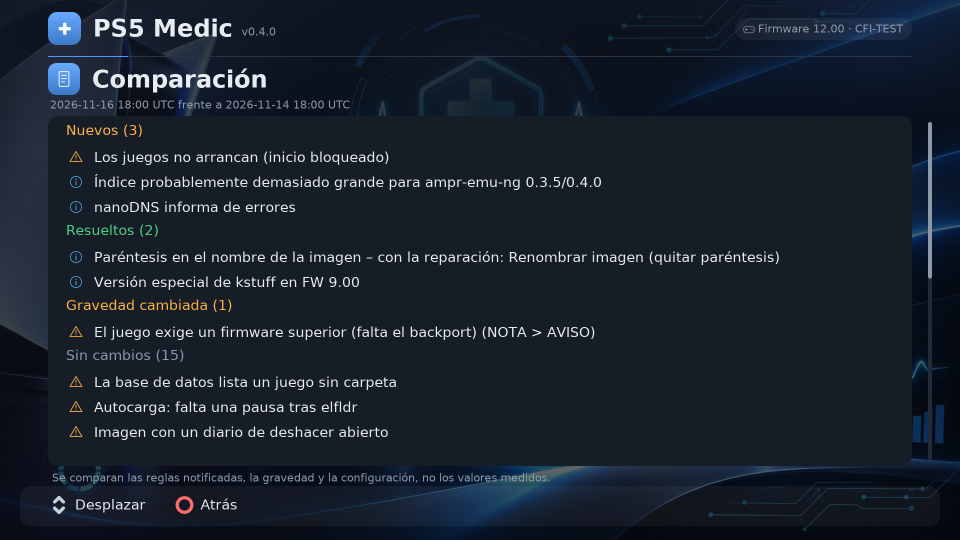
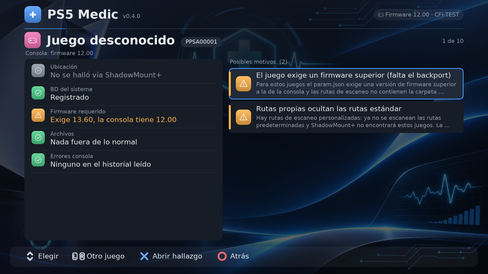
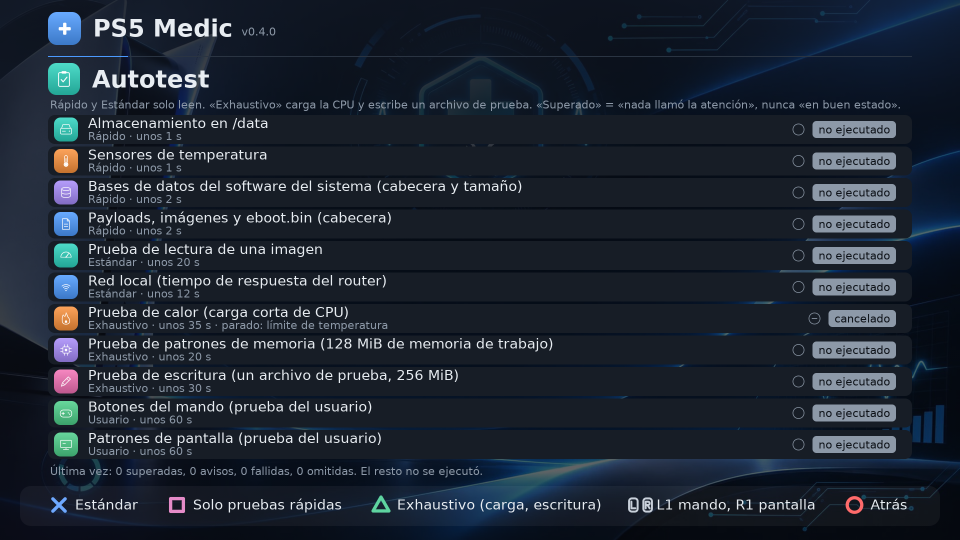
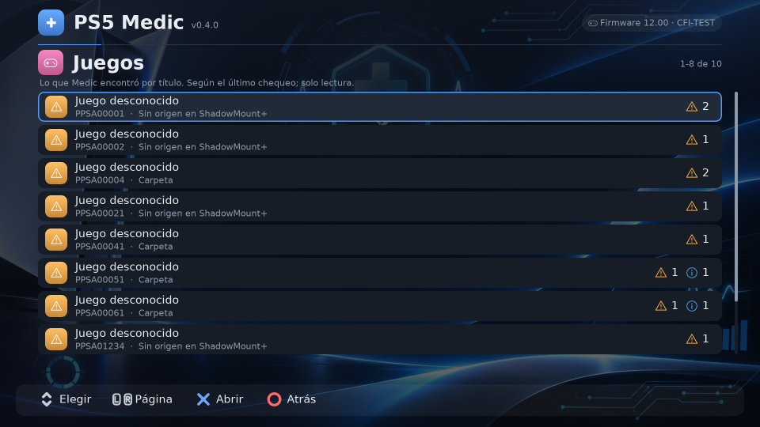
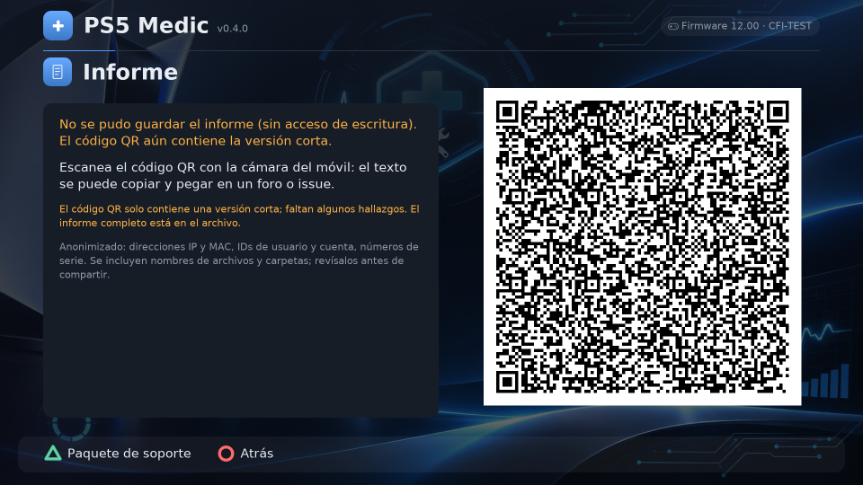

<div align="center">



# PS5 Medic

**Chequeo, diagnóstico en lenguaje claro y reparación segura para consolas PS5 con jailbreak, como aplicación a pantalla completa para el televisor con DualSense.**


[Deutsch](README.md) · [English](README.en.md) · [Français](README.fr.md) · [Italiano](README.it.md) · **Español**

**[⬇ Descargar: última versión](https://github.com/strongt1me/ps5-medic-ui-tool/releases/latest)**



</div>

**PS5 Medic** revisa en una PS5 con jailbreak el **estado en vivo** de la configuración de Homebrew (firmware, cadena de jailbreak, kstuff, ShadowMount+, payloads, juegos, archivos, configuración), explica las causas conocidas de los fallos **en lenguaje claro** y, cuando es posible hacerlo con seguridad, repara **con copia de seguridad y función de deshacer**. Un solo botón: *Iniciar chequeo*.

> **Firmware:** La aplicación funciona con los firmwares **4.00 a 14.10** (siempre que el jailbreak funcione en ellos). Hasta ahora se ha probado en una PS5 Pro con firmware 12.00 y ShadowMount+ 1.7beta12. Otros firmwares y configuraciones no se han probado; por eso las reglas están formuladas ligadas a la versión y cada una está marcada por separado como *confirmada* o *aún no confirmada*.

## Qué puede hacer

<table>
  <tr>
    <td width="50%" valign="top">
      <h3>🩺 Chequeo</h3>
      Más de 100 reglas sobre la cadena de jailbreak y HEN, ShadowMount+, plugins, almacenamiento, carpetas de juegos, bases de datos, cuentas, Kraken Mount, ampr-emu-ng e historial de inicio y de errores. Cada hallazgo tiene gravedad, texto claro, prueba (archivo/línea/valor), fuente y una <b>fiabilidad con motivo</b>. Lo que no se pudo leer aparece como <i>no comprobado</i>, nunca como «correcto». Las advertencias y avisos que no puedes resolver tú mismo se ocultan con <b>Options</b> (nunca los críticos; reaparecen si sube la gravedad).
    </td>
    <td width="50%" valign="top">
      <h3>🎮 Por juego</h3>
      <b>¿Un juego no arranca?</b> La vista «Juegos» reúne todo sobre un título: orígenes (carpeta/imagen), entrada en la base de datos del sistema, firmware requerido y backport, revisión de archivos, errores de la consola, datos guardados, log de ShadowMount+ y los posibles motivos. Si el <b>backport está integrado en el propio juego</b> (la versión del SDK del <code>eboot.bin</code> no supera la del firmware), se reconoce y no se notifica como fallo.
    </td>
  </tr>
  <tr>
    <td valign="top">
      <h3>🛠 Reparar con deshacer</h3>
      Catorce reparaciones reversibles (renombrar una imagen, fijar una clave de ShadowMount+, pasar líneas v1 a las secciones v2, quitar BackPork del autoload, mover duplicados, espera del autoload, entradas de autoload duplicadas o ausentes, activar el autoload, apartar un archivo ELF defectuoso o una imagen vacía, nombre de archivo con mayúsculas incorrectas, restos de transferencias interrumpidas y carpetas de paquete incompletas) y una guía para imágenes anidadas. La vista previa muestra exactamente qué cambia <b>y qué se guarda</b> (copia con tamaño, mover sin copia); sin ✕ no pasa nada. Cada cambio queda en el diario y se puede deshacer. <b>Nunca borrar</b>, solo mover o renombrar.
    </td>
    <td valign="top">
      <h3>🧪 Autotest</h3>
      Once pruebas de la consola: almacenamiento, temperaturas, bases de datos, payloads e imágenes, prueba de lectura, red local (solo el router), prueba de calor, patrones de memoria, prueba de escritura, botones del mando y patrones de pantalla. Cada prueba dice qué <i>no</i> demuestra.
    </td>
  </tr>
  <tr>
    <td valign="top">
      <h3>📚 Códigos de error</h3>
      Obra de consulta con 150 mensajes como CE-108262-9: explicación, pasos según Sony, fuente como texto y como código QR. Después de un chequeo, la entrada muestra lo que Medic ve en la consola.
    </td>
    <td valign="top">
      <h3>🕑 Historial y comparación</h3>
      Cada chequeo se guarda por separado. El más reciente está arriba, los anteriores se pueden desplegar. La comparación muestra nuevo, resuelto (con «con la reparación: …» si Medic lo resolvió), gravedad cambiada, sin cambios y la <b>configuración cambiada</b> (firmware, versión de las reglas, versiones de ShadowMount+, kstuff y ampr-emu-ng, número de juegos).
    </td>
  </tr>
  <tr>
    <td valign="top">
      <h3>📄 Informe y actualización de reglas</h3>
      Informe Markdown con código QR para el móvil (se eliminan direcciones IP/MAC, ID de cuenta y números de serie). El <b>paquete de soporte</b> (△ en el informe) es un ZIP con informes, datos y comparación en el que además los nombres de juegos y títulos se sustituyen por marcadores; la clave solo la guardas tú. Nuevas reglas y códigos de error por archivo o, solo con confirmación, desde tu propia dirección, <b>solo con firma Ed25519 válida</b>.
    </td>
    <td valign="top">
      <h3>🌍 Cinco idiomas</h3>
      Deutsch, English, Français, Italiano y Español (Ajustes; la elección se guarda). Manejo con el DualSense.
    </td>
  </tr>
</table>

## Imágenes

<table>
  <tr>
    <td width="50%"></td>
    <td width="50%"></td>
  </tr>
  <tr>
    <td width="50%"></td>
    <td width="50%"></td>
  </tr>
  <tr>
    <td width="50%"></td>
    <td width="50%"></td>
  </tr>
  <tr>
    <td width="50%"></td>
    <td width="50%"></td>
  </tr>
</table>

## Seguridad

- **Nunca se borra**, solo se mueve o se renombra. Los archivos que se van a cambiar se respaldan antes (`/data/ps5medic/backups/`) y cada cambio queda en el diario (`/data/ps5medic/journal.jsonl`).
- **Nada se escribe sin ✕**: la reparación y el deshacer solo ocurren tras una confirmación expresa en la vista previa. Otras acciones de escritura: el informe (□), la actualización de reglas (✕ en la oferta) y el idioma elegido en `/data/ps5medic/config.ini`, los resultados de cada chequeo (`/data/ps5medic/checks/`, para el historial y la comparación), el diario y el único archivo de prueba del autotest a fondo en `/data/ps5medic` (se sobrescribe, nunca se borra).
- Las reparaciones solo escriben dentro de una lista blanca (carpetas de ShadowMount+, listas de autocarga, las propias rutas de escaneo, `/data/ps5medic`). Nunca bajo `/system`, `/system_ex`, `/dev` ni en la flash. El mosaico es una carpeta en `/data/homebrew/` que copias tú mismo o que crea el instalador `ps5medic-launcher.elf`; el mosaico en sí lo crea ShadowMount+.
- **La red solo se usa para la descarga de reglas**, solo con □ y confirmación, solo hacia la dirección de tu `config.ini`, y no se envía nada salvo una solicitud GET. Aparte hay una prueba de red local en el autotest: solo un intento de conexión al router en el rango de direcciones privado, sin datos, nunca hacia internet.
- Sin exploits, sin cambios de firmware, sin funciones para obtener, desbloquear o distribuir juegos, claves o firmware. PS5 Medic repara el **entorno**, no los contenidos. Nunca recomienda una actualización del software del sistema.

## Requisitos

- Una PS5 que ya tenga jailbreak, con cargador de ELF (puerto 9021) y FTP (aquí puerto 2121).
- **ShadowMount+ debe estar en marcha**: crea el mosaico y da a la app acceso a `/data`. Si está detenido, la app avisa «No se puede leer el archivo del servicio».
- La interfaz consta de dos partes: el **mosaico** (una aplicación nativa que solo muestra y lee el DualSense, por lo que el botón PS vuelve con normalidad a la pantalla de inicio) y el **servicio** `ps5medicservice.elf`, que lee la consola y dibuja la imagen. La aplicación envía ella misma el servicio al cargador de ELF (puerto 9021) al arrancar; **no hace falta ni websrv ni un cargador de Homebrew**. Sin mosaico solo funciona el payload de diagnóstico (`ps5medic.elf`).

## Instalación

1. Copiar las dos carpetas de la versión por FTP a `/data/homebrew/`: `PS5MEDIC` (servicio `ps5medicservice.elf`, payload de diagnóstico `ps5medic.elf`, `rules.json`, `error_codes.json`, icono) y `FAKE42007` (la aplicación nativa).
   Alternativa sin FTP: enviar `ps5medic-launcher.elf` (archivo aparte de la versión, no está en el zip) al cargador de ELF (puerto 9021) (Payload Manager o `nc <ip> 9021 < ps5medic-launcher.elf`). Escribe él mismo las dos carpetas, no inicia nada y no borra nada; registro: `/data/ps5medic/installer.log`.
2. ShadowMount+ crea en unos segundos el mosaico **PS5 Medic** en «Medios».
3. Pulsar el mosaico arranca la aplicación (primero la pantalla de presentación, luego la pantalla de inicio). Al arrancar envía el servicio al cargador de ELF (puerto 9021), que debe estar activo; reiniciar la consola no cambia nada, el mosaico se conserva. ◯ en la pantalla de inicio cierra la aplicación y el servicio.

El mosaico `FAKE42007` sustituye a las vías anteriores (launcher, websrv, mosaicos `FAKE42008` y `FAKE42009`). Si aún quedan mosaicos antiguos, se pueden eliminar en los ajustes de almacenamiento de la PS5. Detalles de la aplicación: [docs/NATIVE.md](docs/NATIVE.md).

## Manejo

| Pantalla | Botones |
|---|---|
| Inicio | ↑↓ elegir · ✕ abrir · ◯ salir |
| Lista de hallazgos | ↑↓ elegir · L1/R1 página · ✕ detalles · △ reparar/guía · □ informe · ◯ atrás |
| Lista de hallazgos (más) | Options ocultar · ← comparar con el último chequeo · → hallazgos ocultos · en el informe △ paquete de soporte |
| Detalle | ←→ hallazgo anterior/siguiente · △ reparar · □ código de error · ◯ atrás |
| Vista previa de reparación | ✕ confirmar (escribe) · ◯ cancelar |
| Juegos | ↑↓ elegir · ✕ abrir · L1/R1 otro juego · ◯ atrás |
| Historial, autotest, códigos de error | La barra de ayuda inferior muestra los botones |

## Payload de diagnóstico

`ps5medic.elf` se ejecuta sin interfaz y **solo lee**: escribe `/data/ps5medic/last_check.txt` y exporta el estado como snapshot a `/data/ps5medic/snapshots/`. El snapshot se puede revisar en el PC con `medic-cli check` (carpeta de fixtures, véase abajo).

## Compilar desde el código fuente

Linux o WSL, CMake, un compilador de C++20. El núcleo y las reglas también se ejecutan en el PC contra carpetas de fixtures.

```bash
make test        # pruebas unitarias, de reglas, de interfaz y de informe sobre todas las fixtures
make host        # medic-cli y la vista previa de la interfaz en PC
make preview SNAP=tests/fixtures/g1_pos OUT=build/preview PREVIEW_ARGS="--lang fr"   # imágenes de la interfaz en PC (de en fr it es)
```

Para la consola se necesita el [ps5-payload-sdk](https://github.com/ps5-payload-dev/sdk) **versión 0.45** (`PS5_PAYLOAD_SDK`) y SDL2 para la PS5 (solo para la interfaz de reserva); las instrucciones de compilación están en [docs/PHASE3.md](docs/PHASE3.md), y la estructura y compilación de la aplicación nativa en [docs/NATIVE.md](docs/NATIVE.md).

```bash
make native-ui                      # aplicación nativa (build-native/FAKE42007)
make ps5-service                    # servicio (ps5medicservice.elf)
make ps5                            # payload de diagnóstico (ps5medic.elf)
make deploy-native PS5_HOST=192.168.1.x # aplicación y servicio a /data/homebrew por FTP (la aplicación debe estar cerrada)
make send-launcher PS5_HOST=192.168.1.x # enviar el instalador al puerto 9021: escribe él mismo la aplicación y el servicio en /data/homebrew (sin FTP)
make dist                           # carpeta de versión y zip en dist/ (solo en local)
```

Herramientas en el PC (`build/medic-cli`):

```bash
medic-cli check   <snapshot-ordner>            # hallazgos
medic-cli report  <snapshot-ordner> [--qr]     # informe, código QR opcional en el terminal
medic-cli fix     <snapshot-ordner> <regel-id> # ver el plan (ejecutar con --apply --yes, ¡solo sobre una copia!)
medic-cli history|undo|export ...
```

## Traducciones

La interfaz está en `ui/i18n/<idioma>.json`; los textos de conocimiento para francés, italiano y español se incluyen como complemento en `knowledge/l10n/` (reglas, códigos de error, autotests). Si falta una entrada, la aplicación muestra inglés. Los informes y los textos dinámicos de la vista previa de reparación (avisos, notas, advertencias y mensajes de error) solo existen en alemán e inglés (fr/it/es muestran inglés). `tools/l10n_extract.py` extrae los textos originales para los traductores y `tools/l10n_check.py <idioma>` revisa una traducción (claves, marcadores de posición, números, códigos, rutas).

## Colaborar

**Se buscan probadores** (otros firmwares y configuraciones): [docs/TESTER.md](docs/TESTER.md). Para notificar problemas, usa la plantilla de issue e incluye el informe (□).

Una regla nueva necesita: una entrada en `knowledge/rules.json` con fuente, un fixture positivo y uno negativo en `tests/fixtures/` y `expect.json`. Las pruebas exigen ambos. Los fixtures son **sintéticos**: los nombres reales de archivos y de juegos no van en el repositorio.

## Documentación

| Archivo | Contenido |
|---|---|
| `CLAUDE.md` | Punto de entrada para Claude Code: objetivo, stack, límites, forma de trabajar |
| `docs/SPEC.md` | Funciones, manejo, no-objetivos |
| `docs/ARCHITECTURE.md` | Módulos, flujo de datos, formato de reglas, seguridad |
| `docs/RULES.md` | Catálogo de reglas con fuentes, estado y desviaciones |
| `docs/DIAGNOSE.md` | Ampliación del diagnóstico: revisiones construidas, decisiones D1–D21, plan de construcción |
| `docs/ROADMAP.md` | Fases 0–5 |
| `docs/PHASE2.md` a `PHASE5.md` | Consola y snapshot, interfaz y contexto de aplicación, informe y versión, actualización de reglas y comunidad |
| `docs/TESTER.md` | Colaborar como probador |
| `docs/COMMUNITY.md` | Enviar informes; cómo se convierten en reglas nuevas y actualizaciones de reglas |
| `docs/NATIVE.md` | La interfaz como aplicación nativa: mosaico, servicio, protocolo, estado |
| `docs/TITLE.md` | Vía anterior (Starter, launcher, websrv), solo como solución de reserva |
| `knowledge/` | Reglas (`rules.json`), códigos de error (`error_codes.json`), traducciones (`l10n/`) y esquemas JSON |

## Licencia y agradecimientos

PS5 Medic se publica bajo la **GNU General Public License, versión 3 o (a elección) cualquier versión posterior** (GPL-3.0-or-later). El texto de la licencia está en [LICENSE](LICENSE) y cada archivo fuente propio lleva una línea SPDX. Esto vale también para la base de datos de reglas `knowledge/rules.json`. Motivo: el ELF final se enlaza con las bibliotecas de ejecución GPLv3 del ps5-payload-sdk. Los componentes de terceros (MIT, zlib, BSD-2-Clause, DejaVu, stb_image) son compatibles con la GPL-3.0 y figuran con sus licencias en [THIRD_PARTY.md](THIRD_PARTY.md).

El repositorio es **público**; los paquetes listos están en [Releases](https://github.com/strongt1me/ps5-medic-ui-tool/releases). Quien distribuya un paquete debe, según la GPL, ofrecer también el código fuente correspondiente.

PS5 Medic es un proyecto de la comunidad y no está vinculado a Sony. El uso es bajo la propia responsabilidad.
