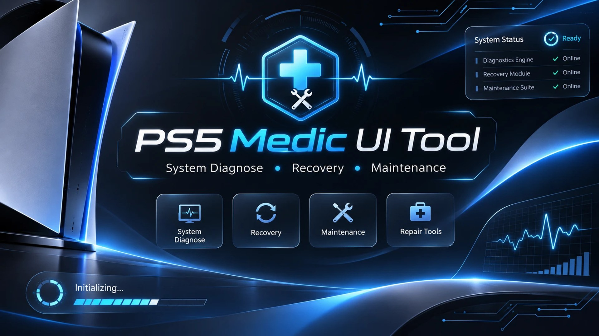
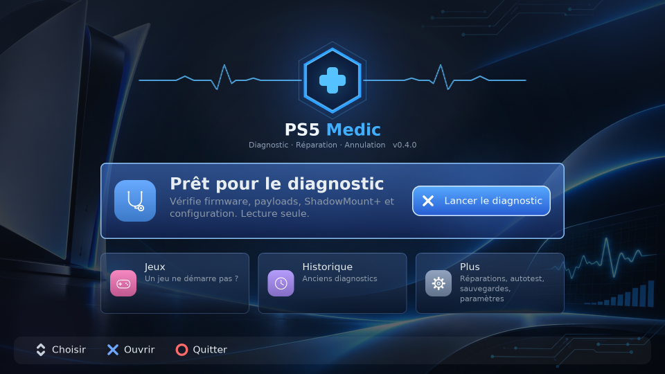
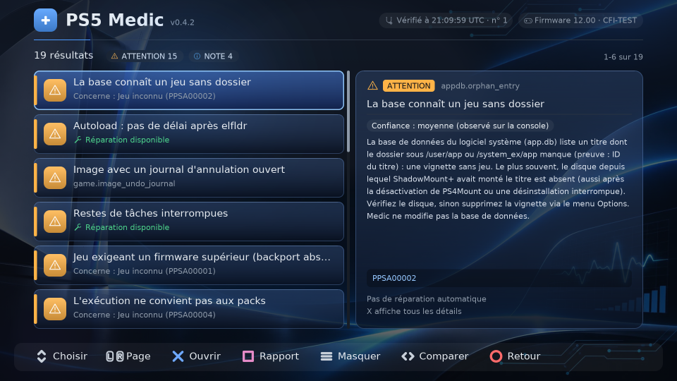
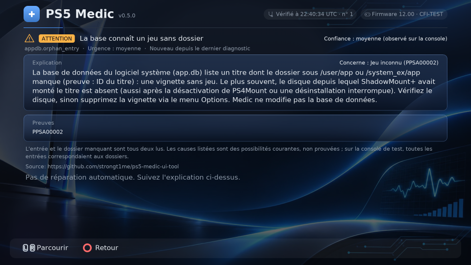
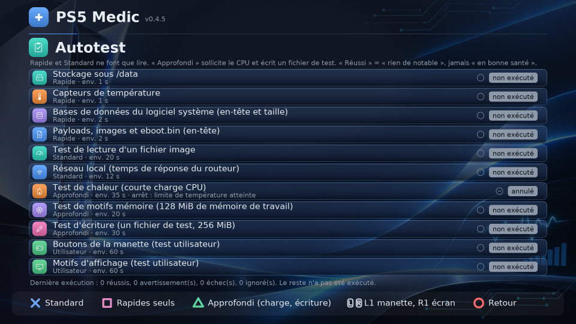

<div align="center">



# PS5 Medic

**Diagnostic, explications en clair et réparation sûre pour les consoles PS5 jailbreakées, sous forme d'application plein écran pour la télévision, avec la DualSense.**


[Deutsch](README.md) · [English](README.en.md) · **Français** · [Italiano](README.it.md) · [Español](README.es.md)



</div>

**PS5 Medic** vérifie sur une PS5 jailbreakée l'**état en direct** de la configuration Homebrew (firmware, chaîne de jailbreak, kstuff, ShadowMount+, payloads, jeux, fichiers, configuration), explique **en clair** les causes d'erreur connues et, lorsque c'est possible en toute sécurité, répare **avec sauvegarde et fonction d'annulation**. Une seule commande : *Lancer le diagnostic*.

> **Firmware :** l'application fonctionne sur les firmwares **4.00 à 14.10** (dans la mesure où le jailbreak y fonctionne). Elle n'a été testée jusqu'ici que sur une PS5 Pro avec le firmware 12.00 et ShadowMount+ 1.7beta12. Les autres firmwares et configurations n'ont pas été testés ; les règles sont donc formulées en fonction de la version et chacune est marquée individuellement comme *confirmée* ou *pas encore confirmée*.

## Fonctionnalités

<table>
  <tr>
    <td width="50%" valign="top">
      <h3>🩺 Diagnostic</h3>
      Plus de 70 règles sur la chaîne de jailbreak et HEN, ShadowMount+, les plugins, le stockage, les dossiers de jeux, les bases de données, les comptes et l'historique de démarrage et d'erreurs. Chaque résultat comporte un niveau de gravité, une explication en clair, une preuve (fichier/ligne/valeur), une source et une <b>fiabilité avec sa justification</b>. Ce qui n'a pas pu être lu apparaît comme <i>non vérifié</i>, jamais comme « en ordre ».
    </td>
    <td width="50%" valign="top">
      <h3>🎮 Par jeu</h3>
      <b>Un jeu ne démarre pas ?</b> La vue « Jeux » rassemble tout ce qui concerne un titre : sources (dossier/image), entrée dans la base de données système, firmware requis et backport, vérification des fichiers, erreurs de la console, sauvegardes, journal de ShadowMount+ et causes possibles. Si le <b>backport est intégré dans le jeu lui-même</b> (la version du SDK de <code>eboot.bin</code> n'est pas supérieure au firmware), cela est reconnu et n'est pas signalé comme une erreur.
    </td>
  </tr>
  <tr>
    <td valign="top">
      <h3>🛠 Réparer avec annulation</h3>
      Sept corrections réversibles (renommer une image, définir la clé ShadowMount+, reporter les lignes v1 dans les sections v2, retirer BackPork de l'Autoload, déplacer les doublons, délai d'attente de l'Autoload, nom de fichier à l'orthographe incorrecte) et un guide pour les images imbriquées. L'aperçu montre exactement ce qui change ; rien ne se passe sans ✕. Chaque modification est inscrite au journal et peut être annulée. <b>Jamais de suppression</b>, uniquement déplacer ou renommer.
    </td>
    <td valign="top">
      <h3>🧪 Autotest</h3>
      Onze tests de la console : stockage, températures, bases de données, payloads et images, test de lecture, réseau local (routeur uniquement), test thermique, motifs mémoire, test d'écriture, touches de la manette et motifs d'affichage. Chaque test indique ce qu'il ne prouve <i>pas</i>.
    </td>
  </tr>
  <tr>
    <td valign="top">
      <h3>📚 Codes d'erreur</h3>
      Ouvrage de référence sur 40 messages tels que CE-108262-9 : explication, étapes selon Sony, source sous forme de texte et de code QR. Après un diagnostic, l'entrée indique ce que Medic constate sur la console.
    </td>
    <td valign="top">
      <h3>🕑 Historique et comparaison</h3>
      Chaque diagnostic est enregistré séparément. Les anciens états peuvent être consultés et comparés entre eux : nouveau, corrigé, inchangé.
    </td>
  </tr>
  <tr>
    <td valign="top">
      <h3>📄 Rapport et mise à jour des règles</h3>
      Rapport Markdown avec code QR pour le téléphone (IP/MAC, ID de compte et numéros de série sont retirés). Nouvelles règles et nouveaux codes d'erreur par fichier ou, uniquement après confirmation, depuis votre propre adresse, <b>uniquement avec une signature Ed25519 valide</b>.
    </td>
    <td valign="top">
      <h3>🌍 Cinq langues</h3>
      Deutsch, English, Français, Italiano et Español (Paramètres, le choix est enregistré). Utilisation avec la DualSense .
    </td>
  </tr>
</table>

## Images

<table>
  <tr>
    <td width="50%"></td>
    <td width="50%"></td>
  </tr>
  <tr>
    <td></td>
    <td></td>
  </tr>
  <tr>
    <td></td>
    <td></td>
  </tr>
</table>

## Sécurité

- **Jamais de suppression**, uniquement déplacer ou renommer. Les fichiers qui sont modifiés sont sauvegardés au préalable (`/data/ps5medic/backups/`), chaque modification est inscrite au journal (`/data/ps5medic/journal.jsonl`).
- **Aucune écriture sans ✕** : la réparation et l'annulation n'ont lieu qu'après une confirmation explicite sur l'aperçu. Autres actions d'écriture : le rapport (□), la mise à jour des règles (✕ sur la proposition), la langue choisie dans `/data/ps5medic/config.ini`.
- Les réparations n'écrivent que dans une liste d'autorisation (dossiers de ShadowMount+, listes d'Autoload, ses propres chemins d'analyse, `/data/ps5medic`). Jamais sous `/system`, `/system_ex`, `/dev` ni dans la mémoire flash. Lorsque le Launcher est envoyé sous forme d'ELF, il crée uniquement son propre dossier `/data/homebrew/FAKE42007` (comme toute autre application) ; la tuile est créée par ShadowMount+.
- **Le réseau n'est utilisé que pour le téléchargement des règles**, uniquement sur □ et après confirmation, uniquement vers l'adresse de votre `config.ini`, et rien n'est envoyé hormis une requête GET. En outre, l'autotest comporte un test de réseau local : uniquement l'établissement d'une connexion vers le routeur, dans la plage d'adresses privées, sans données, jamais vers Internet.
- Aucun exploit, aucune modification du firmware, aucune fonction pour se procurer, déverrouiller ou distribuer des jeux, des clés ou des firmwares. PS5 Medic répare l'**environnement**, pas les contenus. Il ne recommande jamais d'installer une nouvelle version du logiciel système.

## Prérequis

- Une PS5 déjà jailbreakée avec un chargeur d'ELF (port 9021) et FTP (ici port 2121).
- Pour le démarrage avec la DualSense, l'interface a besoin d'un contexte d'application (sinon la console n'ouvre pas la manette ; contexte : [docs/PHASE3.md](docs/PHASE3.md)). C'est le **Starter** de la tuile (un petit titre natif qui envoie le Launcher au chargeur d'ELF) qui le lui fournit ; **ni websrv ni un chargeur Homebrew n'est nécessaire**. Sans la tuile, seul le payload de diagnostic (`ps5medic.elf`) fonctionne.

## Installation

1. Copier le dossier `PS5MEDIC` de la release par FTP vers `/data/homebrew/` (il contient `ps5medicui.elf`, `ps5medic-launcher.elf`, `ps5medic.elf`, `rules.json`, `error_codes.json`, `homebrew.js` et l'icône).
2. Obtenir la tuile, de l'une de ces deux façons :
   - **Envoyer l'ELF :** envoyer `ps5medic-launcher.elf` au port 9021 (Payload Manager, ou depuis le PC : `make send-launcher PS5_HOST=<PS5-IP>`). Il crée le dossier `/data/homebrew/FAKE42007`, ShadowMount+ en installe la tuile **PS5 Medic** sous « Médias », et il lance aussitôt l'interface si aucune application n'est en cours.
   - **Application-dossier :** copier le dossier `FAKE42007` de la release vers `/data/homebrew/` ; ShadowMount+ crée la tuile. Ensuite, une pression sur la tuile lance l'interface sans qu'il soit nécessaire d'envoyer un ELF.
3. Une pression sur la tuile lance l'interface (d'abord l'écran de démarrage, puis l'écran d'accueil). Elle n'a besoin que du chargeur d'ELF (port 9021) de la console ; la tuile reste après un redémarrage.

Le Launcher ne ferme que les fausses applications Homebrew (dont le Starter de la tuile) et les programmes système ; il ne ferme jamais un jeu en cours. Détails : [docs/TITLE.md](docs/TITLE.md).

## Utilisation

| Écran | Touches |
|---|---|
| Accueil | ↑↓ choisir · ✕ ouvrir · ◯ quitter |
| Liste des résultats | ↑↓ choisir · L1/R1 page · ✕ détails · △ réparer/guide · □ rapport · ◯ retour |
| Détail | ←→ résultat précédent/suivant · △ réparer · □ code d'erreur · ◯ retour |
| Aperçu de la réparation | ✕ confirmer (écrit) · ◯ annuler |
| Jeux | ↑↓ choisir · ✕ ouvrir · L1/R1 autre jeu · ◯ retour |
| Historique, autotest, codes d'erreur | la barre d'aide en bas indique les touches |

## Payload de diagnostic

`ps5medic.elf` fonctionne sans interface, **en lecture seule** : il écrit `/data/ps5medic/last_check.txt` et exporte l'état sous forme d'instantané (snapshot) vers `/data/ps5medic/snapshots/`. Cet instantané peut être vérifié sur PC avec `medic-cli check` (dossier de fixtures, voir ci-dessous).

## Compiler depuis le code source

Linux ou WSL, CMake, un compilateur C++20. Le cœur et les règles fonctionnent aussi sur PC avec des dossiers de fixtures.

```bash
make test        # Unit-, Regel-, UI- und Berichts-Tests gegen alle Fixtures
make host        # medic-cli und die PC-Vorschau der UI
make preview SNAP=tests/fixtures/g1_pos OUT=build/preview PREVIEW_ARGS="--lang fr"   # Bilder der UI am PC (de en fr it es)
```

Pour la console, il faut le [ps5-payload-sdk](https://github.com/ps5-payload-dev/sdk) **version 0.45** (`PS5_PAYLOAD_SDK`) et SDL2 pour la PS5 ; la procédure de compilation correspondante se trouve dans [docs/PHASE3.md](docs/PHASE3.md), la compilation de la tuile dans [docs/TITLE.md](docs/TITLE.md).

```bash
make ps5-ui                         # Vollbild-UI (ps5medicui.elf)
make ps5                            # Diagnose-Payload (ps5medic.elf)
make send-launcher PS5_HOST=192.168.1.x # Envoyer le Launcher au port 9021 (crée le dossier FAKE42007 + UI); make title = Ordner-App FAKE42007; make launch-ui = alter Weg über websrv
make dist                           # Release-Ordner und Zip unter dist/ (nur lokal)
```

Outils sur PC (`build/medic-cli`) :

```bash
medic-cli check   <snapshot-ordner>            # Befunde
medic-cli report  <snapshot-ordner> [--qr]     # Bericht, optional QR-Code im Terminal
medic-cli fix     <snapshot-ordner> <regel-id> # Plan ansehen (mit --apply --yes ausführen, nur an einer Kopie!)
medic-cli history|undo|export ...
```

## Traductions

L'interface se trouve dans `ui/i18n/<langue>.json` ; les textes de connaissances pour le français, l'italien et l'espagnol sont fournis en complément dans `knowledge/l10n/` (règles, codes d'erreur, autotests). Si une entrée manque, l'application affiche l'anglais. Les rapports et les indications dynamiques de l'aperçu de réparation n'existent qu'en allemand et en anglais. `tools/l10n_extract.py` extrait les textes sources pour les traducteurs, `tools/l10n_check.py <langue>` vérifie une traduction (clés, espaces réservés, nombres, codes, chemins).

## Contribuer

**Testeurs recherchés** (autres firmwares et configurations) : [docs/TESTER.md](docs/TESTER.md). Signaler les problèmes avec le modèle d'issue, en y collant le rapport (□).

Une nouvelle règle requiert : une entrée dans `knowledge/rules.json` avec une source, une fixture positive et une fixture négative sous `tests/fixtures/` ainsi que `expect.json`. Les tests exigent les deux. Les fixtures sont **synthétiques** : les noms réels de fichiers et de jeux n'ont pas leur place dans le dépôt.

## Documentation

| Fichier | Contenu |
|---|---|
| `CLAUDE.md` | Point d'entrée pour Claude Code : objectif, pile technique, limites, méthode de travail |
| `docs/SPEC.md` | Fonctions, utilisation, non-objectifs |
| `docs/ARCHITECTURE.md` | Modules, flux de données, format des règles, sécurité |
| `docs/RULES.md` | Catalogue des règles avec sources, statut et écarts |
| `docs/DIAGNOSE.md` | Extension du diagnostic : vérifications réalisées, décisions D1–D21, plan de construction |
| `docs/ROADMAP.md` | Phases 0–5 |
| `docs/PHASE2.md` à `PHASE5.md` | Console et snapshot, interface et contexte d'application, rapport et release, mise à jour des règles et communauté |
| `docs/TESTER.md` | Participer en tant que testeur |
| `docs/TITLE.md` | Tuile et démarrage sans chargeur Homebrew : Starter, Launcher, application-dossier |
| `knowledge/` | Règles (`rules.json`), codes d'erreur (`error_codes.json`), traductions (`l10n/`) et schémas JSON |

## Licence et remerciements

PS5 Medic est placé sous la **GNU General Public License, version 3 ou (au choix) toute version ultérieure** (GPL-3.0-or-later). Le texte de la licence se trouve dans [LICENSE](LICENSE), chaque fichier source propre porte une ligne SPDX. Cela vaut aussi pour la base de règles `knowledge/rules.json`. Raison : l'ELF final est lié aux bibliothèques d'exécution sous GPLv3 du ps5-payload-sdk. Les composants tiers (MIT, zlib, BSD-2-Clause, DejaVu, stb_image) sont compatibles avec la GPL-3.0 et figurent avec leurs licences dans [THIRD_PARTY.md](THIRD_PARTY.md).

Le dépôt est **privé**, il n'y a pas de release publique (décision de l'auteur, 8 nov. 2026). Quiconque transmet un paquet issu de `make dist` doit, selon la GPL, proposer aussi le code source correspondant.

PS5 Medic est un projet communautaire et n'est pas affilié à Sony. L'utilisation se fait sous votre propre responsabilité.
