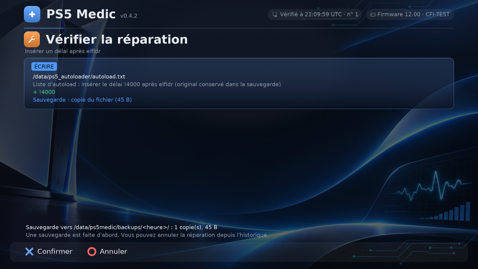
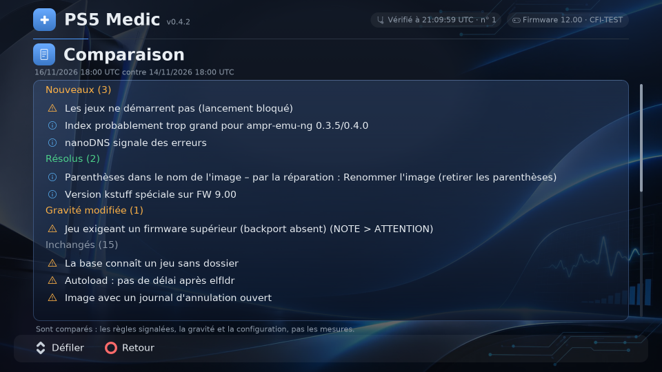
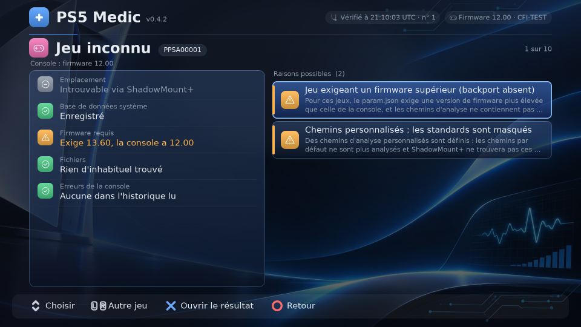
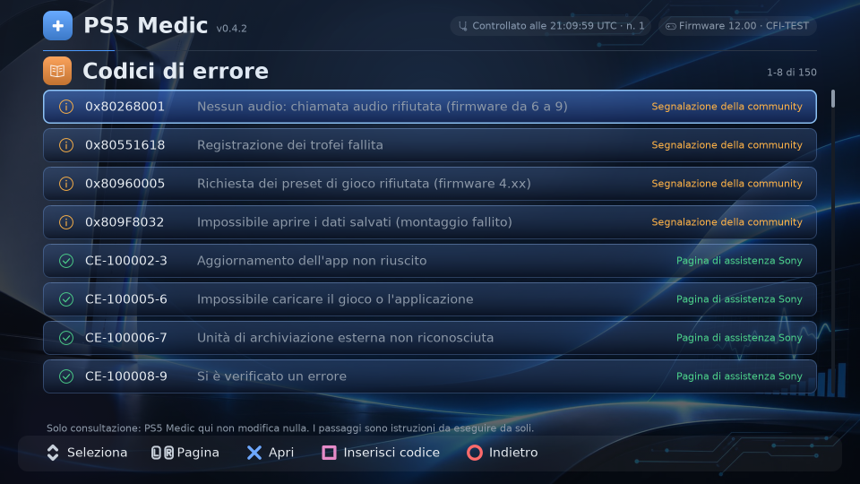
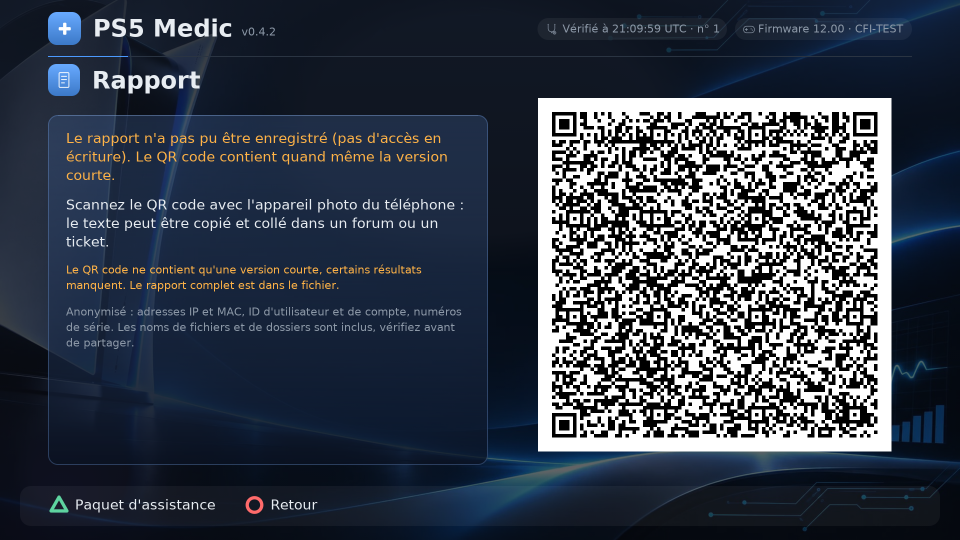

<div align="center">


# PS5 Medic

**Diagnostic, explications en clair et réparation sûre pour les consoles PS5 jailbreakées, sous forme d'application plein écran pour la télévision, avec la DualSense.**


[English](README.md) · [Deutsch](README.de.md) · **Français** · [Italiano](README.it.md) · [Español](README.es.md)

**[⬇ Télécharger : dernière version](https://github.com/strongt1me/ps5-medic-ui-tool/releases/latest)**


</div>

**PS5 Medic** vérifie sur une PS5 jailbreakée l'**état en direct** de la configuration Homebrew (firmware, chaîne de jailbreak, kstuff, ShadowMount+, payloads, jeux, fichiers, configuration), explique **en clair** les causes d'erreur connues et, lorsque c'est possible en toute sécurité, répare **avec sauvegarde et fonction d'annulation**. Une seule commande : *Lancer le diagnostic*.

> **Firmware :** l'application fonctionne sur les firmwares **4.00 à 14.10** (dans la mesure où le jailbreak y fonctionne). Elle n'a été testée jusqu'ici que sur une PS5 Pro avec le firmware 12.00 et ShadowMount+ 1.7beta12. Les autres firmwares et configurations n'ont pas été testés ; les règles sont donc formulées en fonction de la version et chacune est marquée individuellement comme *confirmée* ou *pas encore confirmée*.

## Fonctionnalités

<table>
  <tr>
    <td width="50%" valign="top">
      <h3>🩺 Diagnostic</h3>
      Plus de 100 règles sur la chaîne de jailbreak et HEN, ShadowMount+, les plugins, le stockage, les dossiers de jeux, les bases de données, les comptes, Kraken Mount, ampr-emu-ng ainsi que l'historique de démarrage et d'erreurs. Chaque constat a une gravité, un texte clair, une preuve (fichier/ligne/valeur), une source et une <b>fiabilité avec motif</b>. Ce qui n'a pas pu être lu apparaît comme <i>non vérifié</i>, jamais comme « OK ». Les avertissements et remarques que vous ne pouvez pas corriger vous-même se masquent avec <b>Options</b> (jamais les critiques ; ils reviennent si la gravité augmente).
    </td>
    <td width="50%" valign="top">
      <h3>🎮 Par jeu</h3>
      <b>Un jeu ne démarre pas ?</b> La vue « Jeux » rassemble tout ce qui concerne un titre : sources (dossier/image), entrée dans la base de données système, firmware requis et backport, vérification des fichiers, erreurs de la console, sauvegardes, journal de ShadowMount+ et causes possibles. Si le <b>backport est intégré dans le jeu lui-même</b> (la version du SDK de <code>eboot.bin</code> n'est pas supérieure au firmware), cela est reconnu et n'est pas signalé comme une erreur.
    </td>
  </tr>
  <tr>
    <td valign="top">
      <h3>🛠 Réparer avec annulation</h3>
      Quatorze corrections réversibles (renommer une image, définir la clé ShadowMount+, reporter les lignes v1 dans les sections v2, retirer BackPork de l'autoload, déplacer les doublons, délai de l'autoload, entrées d'autoload en double ou manquantes, activer l'autoload, mettre de côté un fichier ELF défectueux ou une image vide, nom de fichier à la casse incorrecte, restes de transferts interrompus et dossiers de paquet incomplets) et un guide pour les images imbriquées. L'aperçu montre exactement ce qui change <b>et ce qui est sauvegardé</b> (copie avec taille, déplacement sans copie) ; rien ne se passe sans ✕. Chaque modification figure au journal et peut être annulée. <b>Ne jamais supprimer</b>, seulement déplacer ou renommer.
    </td>
    <td valign="top">
      <h3>🧪 Autotest</h3>
      Onze tests de la console : stockage, températures, bases de données, payloads et images, test de lecture, réseau local (routeur uniquement), test thermique, motifs mémoire, test d'écriture, touches de la manette et motifs d'affichage. Chaque test indique ce qu'il ne prouve <i>pas</i>.
    </td>
  </tr>
  <tr>
    <td valign="top">
      <h3>📚 Codes d'erreur</h3>
      Ouvrage de référence sur 150 messages tels que CE-108262-9 : explication, étapes selon Sony, source sous forme de texte et de code QR. Après un diagnostic, l'entrée indique ce que Medic constate sur la console.
    </td>
    <td valign="top">
      <h3>🕑 Historique et comparaison</h3>
      Chaque diagnostic est enregistré séparément. Le plus récent est en haut, les précédents se déplient. La comparaison montre nouveau, résolu (avec « par réparation : … » si Medic l'a corrigé), gravité modifiée, inchangé et la <b>configuration modifiée</b> (firmware, version des règles, versions de ShadowMount+, kstuff et ampr-emu-ng, nombre de jeux).
    </td>
  </tr>
  <tr>
    <td valign="top">
      <h3>📄 Rapport et mise à jour des règles</h3>
      Rapport Markdown avec code QR pour le téléphone (adresses IP/MAC, ID de compte et numéros de série sont retirés). Le <b>paquet d'assistance</b> (△ dans le rapport) est un ZIP avec rapports, faits et comparaison où les noms de jeux et de titres sont en plus remplacés par des repères ; seul vous gardez la clé. Nouvelles règles et codes d'erreur par fichier ou, uniquement après confirmation, depuis votre propre adresse, <b>uniquement avec une signature Ed25519 valide</b>.
    </td>
    <td valign="top">
      <h3>🌍 Cinq langues</h3>
      Deutsch, English, Français, Italiano et Español (Paramètres, le choix est enregistré). Utilisation avec la DualSense .
    </td>
  </tr>
</table>

## Images

<table>
  <tr>
    <td width="50%"></td>
    <td width="50%"></td>
  </tr>
  <tr>
    <td width="50%"></td>
    <td width="50%"></td>
  </tr>
  <tr>
    <td width="50%"></td>
    <td width="50%"></td>
  </tr>
  <tr>
    <td width="50%"></td>
    <td width="50%"></td>
  </tr>
</table>

## Sécurité

- **Jamais de suppression**, uniquement déplacer ou renommer. Les fichiers qui sont modifiés sont sauvegardés au préalable (`/data/ps5medic/backups/`), chaque modification est inscrite au journal (`/data/ps5medic/journal.jsonl`).
- **Aucune écriture sans ✕** : la réparation et l'annulation n'ont lieu qu'après une confirmation explicite sur l'aperçu. Autres actions d'écriture : le rapport (□), la mise à jour des règles (✕ sur la proposition), la langue choisie dans `/data/ps5medic/config.ini`, les résultats de chaque diagnostic (`/data/ps5medic/checks/`, pour l'historique et la comparaison), le journal et l'unique fichier de test de l'autotest approfondi dans `/data/ps5medic` (écrasé, jamais supprimé).
- Les réparations n'écrivent que dans une liste d'autorisation (dossiers de ShadowMount+, listes d'Autoload, ses propres chemins d'analyse, `/data/ps5medic`). Jamais sous `/system`, `/system_ex`, `/dev` ni dans la mémoire flash. La tuile est un dossier sous `/data/homebrew/` que vous copiez vous-même ou que l'installateur `ps5medic-launcher.elf` crée ; la tuile elle-même est créée par ShadowMount+.
- **Le réseau n'est utilisé que pour le téléchargement des règles**, uniquement sur □ et après confirmation, uniquement vers l'adresse de votre `config.ini`, et rien n'est envoyé hormis une requête GET. En outre, l'autotest comporte un test de réseau local : uniquement l'établissement d'une connexion vers le routeur, dans la plage d'adresses privées, sans données, jamais vers Internet.
- Aucun exploit, aucune modification du firmware, aucune fonction pour se procurer, déverrouiller ou distribuer des jeux, des clés ou des firmwares. PS5 Medic répare l'**environnement**, pas les contenus. Il ne recommande jamais d'installer une nouvelle version du logiciel système.

## Prérequis

- Une PS5 déjà jailbreakée avec un chargeur d'ELF (port 9021) et FTP (ici port 2121).
- **ShadowMount+ doit être lancé** : il crée la vignette et donne à l'app l'accès à `/data`. S'il est arrêté, l'app signale « Fichier du service illisible ».
- L'interface se compose de deux parties : la **tuile** (une application native qui se contente d'afficher et de lire la DualSense, si bien que la touche PS ramène normalement à l'écran d'accueil) et le **service** `ps5medicservice.elf`, qui lit la console et dessine l'image. L'application envoie elle-même le service au chargeur d'ELF (port 9021) au démarrage ; **ni websrv ni un chargeur Homebrew n'est nécessaire**. Sans la tuile, seul le payload de diagnostic (`ps5medic.elf`) fonctionne.

## Installation

1. Copier les deux dossiers de la release par FTP vers `/data/homebrew/` : `PS5MEDIC` (service `ps5medicservice.elf`, payload de diagnostic `ps5medic.elf`, `rules.json`, `error_codes.json`, icône) et `FAKE42007` (l'application native).
   Alternative sans FTP : envoyer `ps5medic-launcher.elf` (fichier séparé de la release, pas dans le zip) au chargeur d'ELF (port 9021) (Payload Manager ou `nc <ip> 9021 < ps5medic-launcher.elf`). Il écrit lui-même les deux dossiers, ne démarre rien et ne supprime rien ; journal : `/data/ps5medic/installer.log`.
2. ShadowMount+ crée en quelques secondes la tuile **PS5 Medic** sous « Médias ».
3. Une pression sur la tuile lance l'application (d'abord l'écran de démarrage, puis l'écran d'accueil). Au démarrage, elle envoie le service au chargeur d'ELF (port 9021), qui doit fonctionner ; un redémarrage de la console n'y change rien, la tuile reste. ◯ sur l'écran d'accueil ferme l'application et le service.

La tuile `FAKE42007` remplace les anciennes méthodes (Launcher, websrv, tuiles `FAKE42008` et `FAKE42009`). S'il reste d'anciennes tuiles, elles peuvent être supprimées dans les paramètres de stockage de la PS5. Détails sur l'application : [docs/NATIVE.md](docs/NATIVE.md).

## Utilisation

| Écran | Touches |
|---|---|
| Accueil | ↑↓ choisir · ✕ ouvrir · ◯ quitter |
| Liste des résultats | ↑↓ choisir · L1/R1 page · ✕ détails · △ réparer/guide · □ rapport · ◯ retour |
| Liste des constats (suite) | Options masquer · ← comparer avec le dernier diagnostic · → constats masqués · dans le rapport △ paquet d'assistance |
| Détail | ←→ résultat précédent/suivant · △ réparer · □ code d'erreur · ◯ retour |
| Aperçu de la réparation | ✕ confirmer (écrit) · ◯ annuler |
| Jeux | ↑↓ choisir · ✕ ouvrir · L1/R1 autre jeu · ◯ retour |
| Historique, autotest, codes d'erreur | la barre d'aide en bas indique les touches |

## Payload de diagnostic

`ps5medic.elf` fonctionne sans interface, **en lecture seule** : il écrit `/data/ps5medic/last_check.txt` et exporte l'état sous forme d'instantané (snapshot) vers `/data/ps5medic/snapshots/`. Cet instantané peut être vérifié sur PC avec `medic-cli check` (dossier de fixtures, voir ci-dessous).

## Compiler depuis le code source

Linux ou WSL, CMake, un compilateur C++20. Le cœur et les règles fonctionnent aussi sur PC avec des dossiers de fixtures.

```bash
make test        # tests unitaires, de règles, d'interface et de rapport sur toutes les fixtures
make host        # medic-cli et l'aperçu de l'interface sur PC
make preview SNAP=tests/fixtures/g1_pos OUT=build/preview PREVIEW_ARGS="--lang fr"   # images de l'interface sur PC (de en fr it es)
```

Pour la console, il faut le [ps5-payload-sdk](https://github.com/ps5-payload-dev/sdk) **version 0.45** (`PS5_PAYLOAD_SDK`) et SDL2 pour la PS5 (uniquement pour l'interface de secours) ; la procédure de compilation correspondante se trouve dans [docs/PHASE3.md](docs/PHASE3.md), la structure et la compilation de l'application native dans [docs/NATIVE.md](docs/NATIVE.md).

```bash
make native-ui                      # application native (build-native/FAKE42007)
make ps5-service                    # service (ps5medicservice.elf)
make ps5                            # payload de diagnostic (ps5medic.elf)
make deploy-native PS5_HOST=192.168.1.x # application et service vers /data/homebrew par FTP (l'application doit être fermée)
make send-launcher PS5_HOST=192.168.1.x # envoyer l'installateur au port 9021 : il écrit lui-même l'application et le service dans /data/homebrew (sans FTP)
make dist                           # dossier de version et zip sous dist/ (uniquement en local)
```

Outils sur PC (`build/medic-cli`) :

```bash
medic-cli check   <snapshot-ordner>            # constats
medic-cli report  <snapshot-ordner> [--qr]     # rapport, code QR facultatif dans le terminal
medic-cli fix     <snapshot-ordner> <regel-id> # voir le plan (exécuter avec --apply --yes, uniquement sur une copie !)
medic-cli history|undo|export ...
```

## Traductions

L'interface se trouve dans `ui/i18n/<langue>.json` ; les textes de connaissances pour le français, l'italien et l'espagnol sont fournis en complément dans `knowledge/l10n/` (règles, codes d'erreur, autotests). Si une entrée manque, l'application affiche l'anglais. Les rapports et les textes dynamiques de l'aperçu de réparation (indications, remarques, avertissements et messages d'erreur) existent dans les cinq langues ; l'outil en ligne de commande `medic-cli` sur le PC ne connaît que l'allemand et l'anglais. `tools/l10n_extract.py` extrait les textes sources pour les traducteurs, `tools/l10n_check.py <langue>` vérifie une traduction (clés, espaces réservés, nombres, codes, chemins).

## Contribuer

**Testeurs recherchés** (autres firmwares et configurations) : [docs/TESTER.md](docs/TESTER.md). Signaler les problèmes avec le modèle d'issue, en y collant le rapport (□).

Une nouvelle règle requiert : une entrée dans `knowledge/rules.json` avec une source, une fixture positive et une fixture négative sous `tests/fixtures/` ainsi que `expect.json`. Les tests exigent les deux. Les fixtures sont **synthétiques** : les noms réels de fichiers et de jeux n'ont pas leur place dans le dépôt.

## Documentation

| Fichier | Contenu |
|---|---|
| `CLAUDE.md` | Point d'entrée pour Claude Code : objectif, pile technique, limites, méthode de travail |
| `docs/SPEC.md` | Fonctions, utilisation, non-objectifs |
| `docs/ARCHITECTURE.md` | Modules, flux de données, format des règles, sécurité |
| `docs/RULES.md` | Catalogue des règles avec sources, statut et écarts |
| `docs/DIAGNOSE.md` | Extension du diagnostic : vérifications réalisées, décisions D1–D21, plan de construction |
| `docs/ROADMAP.md` | Phases 0–5 |
| `docs/PHASE2.md` à `PHASE5.md` | Console et snapshot, interface et contexte d'application, rapport et release, mise à jour des règles et communauté |
| `docs/TESTER.md` | Participer en tant que testeur |
| `docs/COMMUNITY.md` | Envoyer des rapports ; comment ils deviennent de nouvelles règles et des mises à jour des règles |
| `docs/NATIVE.md` | L'interface comme application native : tuile, service, protocole, état |
| `docs/TITLE.md` | Ancienne méthode (Starter, Launcher, websrv), conservée uniquement comme solution de secours |
| `knowledge/` | Règles (`rules.json`), codes d'erreur (`error_codes.json`), traductions (`l10n/`) et schémas JSON |

## Licence et remerciements

PS5 Medic est placé sous la **GNU General Public License, version 3 ou (au choix) toute version ultérieure** (GPL-3.0-or-later). Le texte de la licence se trouve dans [LICENSE](LICENSE), chaque fichier source propre porte une ligne SPDX. Cela vaut aussi pour la base de règles `knowledge/rules.json`. Raison : l'ELF final est lié aux bibliothèques d'exécution sous GPLv3 du ps5-payload-sdk. Les composants tiers (MIT, zlib, BSD-2-Clause, DejaVu, stb_image) sont compatibles avec la GPL-3.0 et figurent avec leurs licences dans [THIRD_PARTY.md](THIRD_PARTY.md).

Le dépôt est **public** ; les paquets prêts à l'emploi se trouvent sous [Releases](https://github.com/strongt1me/ps5-medic-ui-tool/releases). Quiconque transmet un paquet doit, selon la GPL, aussi proposer le code source correspondant.

PS5 Medic est un projet communautaire et n'est pas affilié à Sony. L'utilisation se fait sous votre propre responsabilité.
