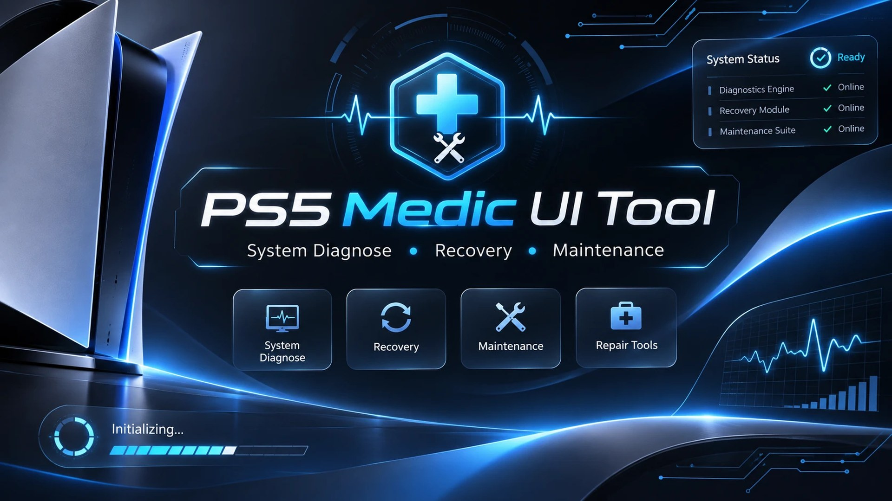
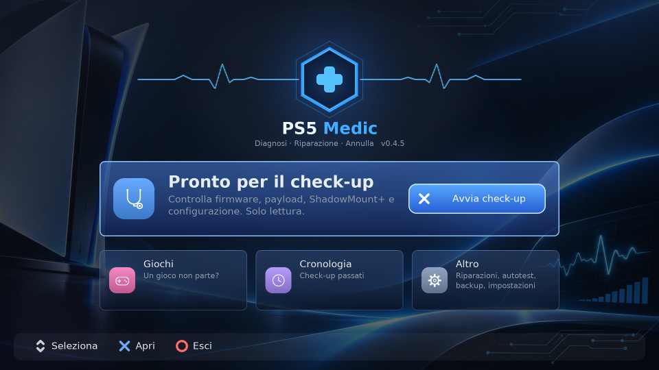
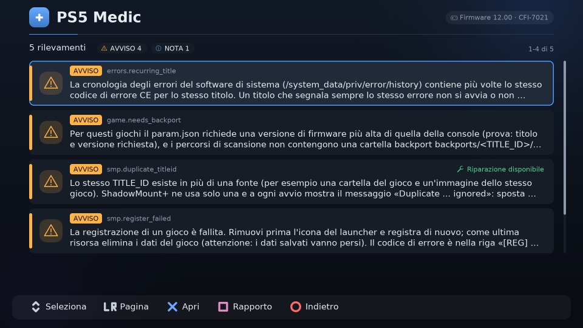
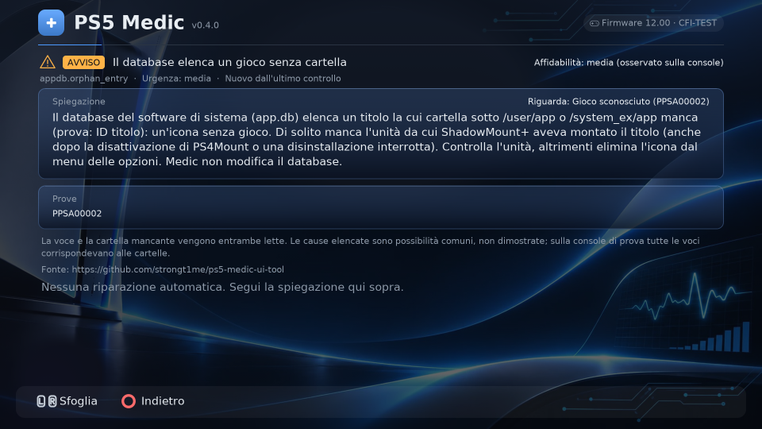
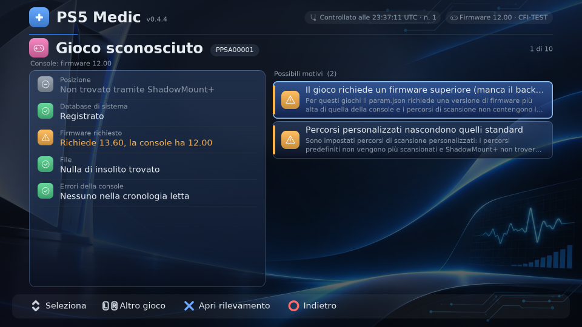
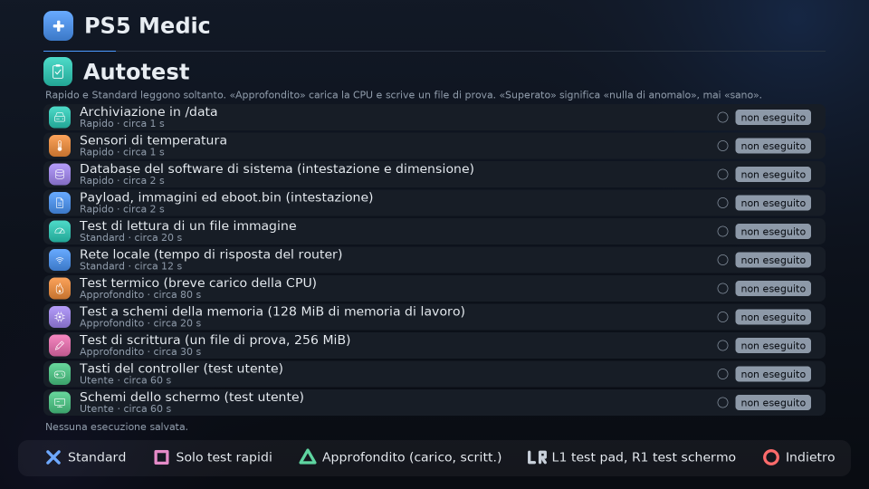
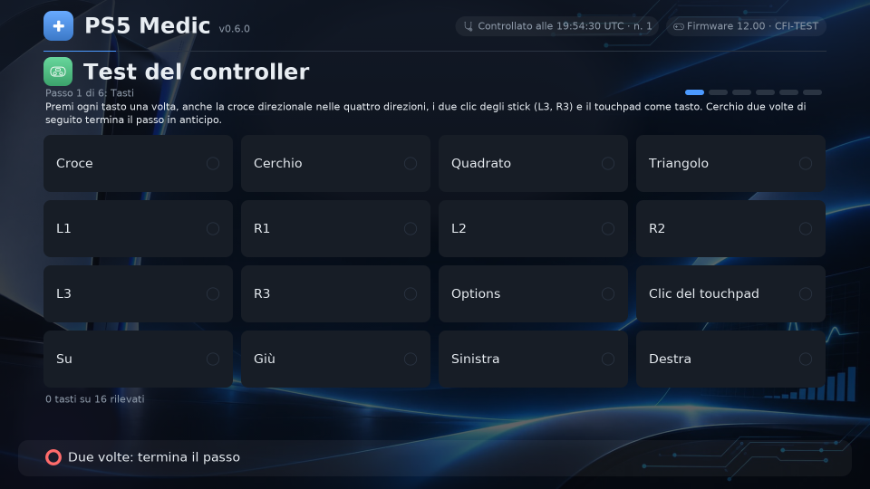

<div align="center">



# PS5 Medic

**Check-up, diagnosi in linguaggio semplice e riparazione sicura per console PS5 con jailbreak, come app a schermo intero per il televisore con DualSense.**


[Deutsch](README.md) · [English](README.en.md) · [Français](README.fr.md) · **Italiano** · [Español](README.es.md)



</div>

**PS5 Medic** controlla su una PS5 con jailbreak lo **stato attuale** della configurazione Homebrew (firmware, catena del jailbreak, kstuff, ShadowMount+, payload, giochi, file, configurazione), spiega le cause note degli errori **in linguaggio semplice** e, dove è possibile farlo in modo sicuro, ripara **con backup e funzione di annullamento**. Un solo tasto: *Avvia check-up*.

> **Firmware:** l'app funziona con i firmware da **4.00 a 14.10** (se il jailbreak funziona su quella versione). Finora è stata provata su una PS5 Pro con firmware 12.00 e ShadowMount+ 1.7beta12. Gli altri firmware e le altre configurazioni non sono stati provati; per questo le regole sono formulate in base alla versione e contrassegnate singolarmente come *confermate* o *non ancora confermate*.

## Cosa sa fare

<table>
  <tr>
    <td width="50%" valign="top">
      <h3>🩺 Check-up</h3>
      Oltre 70 regole su catena del jailbreak e HEN, ShadowMount+, plugin, memoria, cartelle dei giochi, database, account e cronologia di avvii ed errori. Ogni rilevamento ha gravità, spiegazione in linguaggio semplice, prova (file/riga/valore), fonte e un'<b>affidabilità con motivazione</b>. Ciò che non ha potuto essere letto compare come <i>non controllato</i>, mai come «a posto».
    </td>
    <td width="50%" valign="top">
      <h3>🎮 Per gioco</h3>
      <b>Il gioco non si avvia?</b> La vista «Giochi» riunisce tutto su un titolo: fonti (cartella/immagine), voce nel database di sistema, firmware richiesto e backport, controllo dei file, errori della console, salvataggi, log di ShadowMount+ e possibili cause. Se il <b>backport è integrato nel gioco stesso</b> (la versione SDK dell'<code>eboot.bin</code> non supera il firmware), viene riconosciuto e non segnalato come errore.
    </td>
  </tr>
  <tr>
    <td valign="top">
      <h3>🛠 Riparare con annullamento</h3>
      Sette correzioni reversibili (rinominare l'immagine, impostare la chiave di ShadowMount+, trasferire le righe v1 nelle sezioni v2, togliere BackPork dall'autoload, spostare i duplicati, tempo di attesa dell'autoload, nome di file con grafia errata) e una guida per le immagini annidate. L'anteprima mostra esattamente cosa cambia; non succede nulla senza ✕. Ogni modifica è registrata nel journal e può essere annullata. <b>Mai eliminare</b>, solo spostare o rinominare.
    </td>
    <td valign="top">
      <h3>🧪 Autotest</h3>
      Undici test della console: memoria, temperature, database, payload e immagini, test di lettura, rete locale (solo router), test termico, schemi di memoria, test di scrittura, tasti del controller e schemi di visualizzazione. Ogni test dice cosa <i>non</i> dimostra.
    </td>
  </tr>
  <tr>
    <td valign="top">
      <h3>📚 Codici di errore</h3>
      Opera di consultazione su 40 messaggi come CE-108262-9: spiegazione, passaggi secondo Sony, fonte come testo e codice QR. Dopo un check-up la voce mostra ciò che Medic vede sulla console.
    </td>
    <td valign="top">
      <h3>🕑 Cronologia e confronto</h3>
      Ogni check-up viene salvato singolarmente. Gli stati precedenti si possono consultare e confrontare tra loro: nuovo, risolto, invariato.
    </td>
  </tr>
  <tr>
    <td valign="top">
      <h3>📄 Rapporto e aggiornamento delle regole</h3>
      Rapporto in Markdown con codice QR per il telefono (IP/MAC, ID account e numeri di serie vengono rimossi). Nuove regole e nuovi codici di errore tramite file oppure, solo dopo conferma, dal proprio indirizzo, <b>solo con firma Ed25519 valida</b>.
    </td>
    <td valign="top">
      <h3>🌍 Cinque lingue</h3>
      Deutsch, English, Français, Italiano ed Español (Impostazioni, la scelta viene salvata). Uso con il DualSense.
    </td>
  </tr>
</table>

## Immagini

<table>
  <tr>
    <td width="50%"></td>
    <td width="50%"></td>
  </tr>
  <tr>
    <td></td>
    <td></td>
  </tr>
  <tr>
    <td></td>
    <td></td>
  </tr>
</table>

## Sicurezza

- **Mai eliminare**, solo spostare o rinominare. I file che vengono modificati sono prima salvati in backup (`/data/ps5medic/backups/`); ogni modifica è registrata nel journal (`/data/ps5medic/journal.jsonl`).
- **Nessuna scrittura senza ✕**: riparazione e annullamento avvengono solo dopo conferma esplicita nell'anteprima. Altre azioni di scrittura: il rapporto (□), l'aggiornamento delle regole (✕ sulla proposta), la lingua scelta in `/data/ps5medic/config.ini`.
- Le riparazioni scrivono solo in una whitelist (cartelle di ShadowMount+, elenchi di autoload, i propri percorsi di scansione, `/data/ps5medic`). Mai sotto `/system`, `/system_ex`, `/dev` o nella flash. Se il launcher viene inviato come ELF, crea soltanto la propria cartella `/data/homebrew/FAKE42007` (come ogni altra app); il riquadro lo crea ShadowMount+.
- **La rete viene usata solo per il download delle regole**, solo su □ e conferma, solo verso l'indirizzo del tuo `config.ini`, e non viene inviato nulla oltre a una richiesta GET. Inoltre nell'autotest c'è un test della rete locale: solo una connessione al router nell'intervallo di indirizzi privato, senza dati, mai verso Internet.
- Nessun exploit, nessuna modifica del firmware, nessuna funzione per procurarsi, sbloccare o distribuire giochi, chiavi o firmware. PS5 Medic ripara l'**ambiente**, non i contenuti. Non consiglia mai un aggiornamento del software di sistema.

## Requisiti

- Una PS5 già con jailbreak, con ELF loader (porta 9021) e FTP (qui porta 2121).
- Per l'avvio con il DualSense l'interfaccia ha bisogno di un contesto app (altrimenti la console non apre il controller; background: [docs/PHASE3.md](docs/PHASE3.md)). Glielo dà lo **starter** del riquadro (un piccolo titolo nativo che invia il launcher all'ELF loader); **non servono né websrv né un loader Homebrew**. Senza riquadro funziona solo il payload di diagnosi (`ps5medic.elf`).

## Installazione

1. Copiare la cartella `PS5MEDIC` della release via FTP in `/data/homebrew/` (contiene `ps5medicui.elf`, `ps5medic-launcher.elf`, `ps5medic.elf`, `rules.json`, `error_codes.json`, `homebrew.js` e l'icona).
2. Ottenere il riquadro, in uno dei due modi:
   - **Inviare l'ELF:** inviare `ps5medic-launcher.elf` alla porta 9021 (Payload Manager, oppure dal PC: `make send-launcher PS5_HOST=<PS5-IP>`). Crea la cartella `/data/homebrew/FAKE42007`, ShadowMount+ ne installa il riquadro **PS5 Medic** sotto «Media» e avvia subito l'interfaccia se non è in esecuzione alcuna app.
   - **App-cartella:** copiare la cartella `FAKE42007` della release in `/data/homebrew/`; ShadowMount+ crea il riquadro. Dopodiché una pressione sul riquadro avvia l'interfaccia, senza dover inviare un ELF.
3. Una pressione sul riquadro avvia l'interfaccia (prima la schermata di avvio, poi la schermata iniziale). Serve solo l'ELF loader (porta 9021) della console; dopo un riavvio il riquadro resta.

Il launcher chiude solo le app Homebrew false (tra cui lo starter del riquadro) e i programmi di sistema; non chiude mai un gioco in esecuzione. Dettagli: [docs/TITLE.md](docs/TITLE.md).

## Uso

| Schermata | Tasti |
|---|---|
| Avvio | ↑↓ scegliere · ✕ aprire · ◯ uscire |
| Elenco dei rilevamenti | ↑↓ scegliere · L1/R1 pagina · ✕ dettagli · △ riparare/guida · □ rapporto · ◯ indietro |
| Dettaglio | ←→ rilevamento precedente/successivo · △ riparare · □ codice di errore · ◯ indietro |
| Anteprima della riparazione | ✕ confermare (scrive) · ◯ annullare |
| Giochi | ↑↓ scegliere · ✕ aprire · L1/R1 altro gioco · ◯ indietro |
| Cronologia, autotest, codici di errore | la barra dei suggerimenti in basso mostra i tasti |

## Payload di diagnosi

`ps5medic.elf` funziona senza interfaccia, **solo in lettura**: scrive `/data/ps5medic/last_check.txt` ed esporta lo stato come snapshot in `/data/ps5medic/snapshots/`. Lo snapshot si può controllare al PC con `medic-cli check` (cartella fixture, vedi sotto).

## Compilare dal codice sorgente

Linux o WSL, CMake, un compilatore C++20. Il nucleo e le regole funzionano anche al PC contro cartelle fixture.

```bash
make test        # Unit-, Regel-, UI- und Berichts-Tests gegen alle Fixtures
make host        # medic-cli und die PC-Vorschau der UI
make preview SNAP=tests/fixtures/g1_pos OUT=build/preview PREVIEW_ARGS="--lang fr"   # Bilder der UI am PC (de en fr it es)
```

Per la console servono il [ps5-payload-sdk](https://github.com/ps5-payload-dev/sdk) **versione 0.45** (`PS5_PAYLOAD_SDK`) e SDL2 per la PS5; le istruzioni di compilazione si trovano in [docs/PHASE3.md](docs/PHASE3.md), la compilazione del riquadro in [docs/TITLE.md](docs/TITLE.md).

```bash
make ps5-ui                         # Vollbild-UI (ps5medicui.elf)
make ps5                            # Diagnose-Payload (ps5medic.elf)
make send-launcher PS5_HOST=192.168.1.x # Inviare il launcher alla porta 9021 (crea la cartella FAKE42007 + UI); make title = Ordner-App FAKE42007; make launch-ui = alter Weg über websrv
make dist                           # Release-Ordner und Zip unter dist/ (nur lokal)
```

Strumenti al PC (`build/medic-cli`):

```bash
medic-cli check   <snapshot-ordner>            # Befunde
medic-cli report  <snapshot-ordner> [--qr]     # Bericht, optional QR-Code im Terminal
medic-cli fix     <snapshot-ordner> <regel-id> # Plan ansehen (mit --apply --yes ausführen, nur an einer Kopie!)
medic-cli history|undo|export ...
```

## Traduzioni

L'interfaccia si trova in `ui/i18n/<lingua>.json`; i testi di conoscenza per francese, italiano e spagnolo sono presenti come integrazione in `knowledge/l10n/` (regole, codici di errore, autotest). Se manca una voce, l'app mostra l'inglese. I rapporti e i suggerimenti dinamici dell'anteprima della riparazione esistono solo in tedesco e inglese. `tools/l10n_extract.py` estrae i testi sorgente per i traduttori, `tools/l10n_check.py <lingua>` controlla una traduzione (chiavi, segnaposto, numeri, codici, percorsi).

## Contribuire

**Cercasi tester** (altri firmware e altre configurazioni): [docs/TESTER.md](docs/TESTER.md). Segnalare i problemi con il modello di issue, incollando il rapporto (□).

Una nuova regola richiede: una voce in `knowledge/rules.json` con fonte, una fixture positiva e una negativa in `tests/fixtures/` e `expect.json`. I test impongono entrambe. Le fixture sono **sintetiche**: nomi reali di file e giochi non appartengono al repository.

## Documentazione

| File | Contenuto |
|---|---|
| `CLAUDE.md` | Punto di ingresso per Claude Code: obiettivo, stack, limiti, modo di lavorare |
| `docs/SPEC.md` | Funzioni, uso, non-obiettivi |
| `docs/ARCHITECTURE.md` | Moduli, flusso dei dati, formato delle regole, sicurezza |
| `docs/RULES.md` | Catalogo delle regole con fonti, stato e scostamenti |
| `docs/DIAGNOSE.md` | Ampliamento della diagnosi: controlli realizzati, decisioni D1–D21, piano di sviluppo |
| `docs/ROADMAP.md` | Fasi 0–5 |
| `docs/PHASE2.md` fino a `PHASE5.md` | Console e snapshot, interfaccia e contesto app, rapporto e release, aggiornamento delle regole e community |
| `docs/TESTER.md` | Partecipare come tester |
| `docs/TITLE.md` | Riquadro e avvio senza loader Homebrew: starter, launcher, app-cartella |
| `knowledge/` | Regole (`rules.json`), codici di errore (`error_codes.json`), traduzioni (`l10n/`) e schemi JSON |

## Licenza e ringraziamenti

PS5 Medic è distribuito sotto la **GNU General Public License, versione 3 o (a scelta) qualsiasi versione successiva** (GPL-3.0-or-later). Il testo della licenza si trova in [LICENSE](LICENSE); ogni file sorgente proprio reca una riga SPDX. Ciò vale anche per il database delle regole `knowledge/rules.json`. Motivo: l'ELF finito si collega alle librerie runtime GPLv3 del ps5-payload-sdk. I componenti di terze parti (MIT, zlib, BSD-2-Clause, DejaVu, stb_image) sono compatibili con la GPL-3.0 e sono elencati con le loro licenze in [THIRD_PARTY.md](THIRD_PARTY.md).

Il repository è **privato**, non esiste una release pubblica (decisione dell'autore, 8 nov. 2026). Chi distribuisce un pacchetto creato con `make dist` deve, secondo la GPL, offrire anche il relativo codice sorgente.

PS5 Medic è un progetto della community e non è affiliato a Sony. L'uso avviene a proprio rischio.
